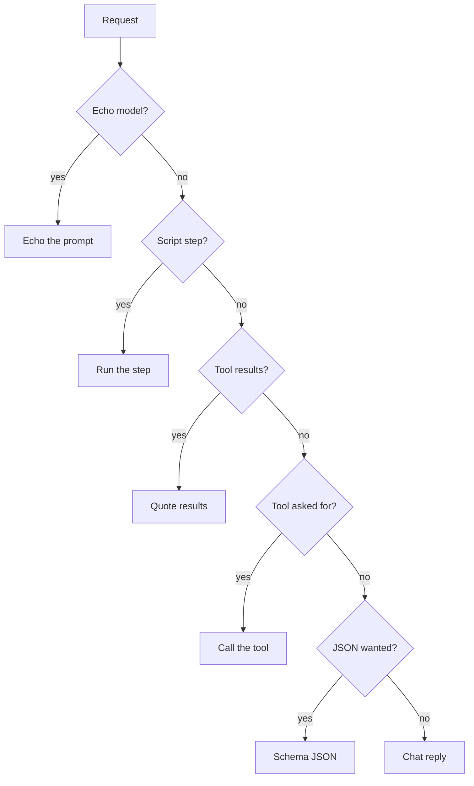

# Fake LLMs for testing: the state of existing practice, and what CheapSeek should adopt

- Date: 2026-11-22
- Purpose: advice for the first build of CheapSeek
- Evidence: six research files in this repo's `research` folder, written the same day from live web pages, plus a direct read of the two Rust ports of PyBot on GitHub
- Method: reading only - documentation, READMEs and source files

## 1. Summary

CheapSeek is a small server that pretends to be an LLM. It speaks the OpenAI chat-completions API, answers from rules instead of a neural network, and exists so that the tests of a gateway and an agent harness can run fast, locally, and with the same result every time.

Plenty of people have built something like it. This report sorts that work into six families, one section each:

- **Standalone mock LLM servers** (section 2): HTTP servers that answer from fixtures, templates or filler text.
- **Fake models inside frameworks** (section 3): stand-ins that sit behind a framework's model interface.
- **Agent harness test doubles** (section 4): how Codex, Goose, Zed and others script the model in their own loop tests.
- **Inference simulators** (section 5): fake backends for gateways, routers and benchmark tools.
- **Rule-based chatbots and text generators** (section 6): ELIZA, PyBot and its ports, schema fakers, tiny real models.
- **Record and replay** (section 7): cassettes of real model traffic.

Five findings shape the advice:

1. **The best designs compute the reply from the request alone.** A short ladder of checks picks it: echo the prompt, quote tool results, call a tool, emit schema-valid JSON, or fall through to chat text. [Rustybin](https://docs.rustybin.dev/ai/behaviour.html) documents the full ladder, and [VidaiMock](https://github.com/vidaiUK/VidaiMock) and Pydantic AI's `TestModel` each hold a part of it.
2. **Steering through the model name and the prompt text is established practice.** It uses only what the OpenAI API already has, and it is the kind of control that passes through a gateway untouched.
3. **Tool calls take three small parts:** a rule that decides when to call, a generator that builds arguments from the tool's JSON schema, and a rule that answers in text once tool results arrive, so every loop ends.
4. **Exact token counting is cheap and pays for itself.** One simple rule makes `usage`, `max_tokens`, `finish_reason` and the number of stream deltas all assertable.
5. **Chat text is the expensive part.** The ladder answers in microseconds. A Rust port of PyBot takes 30 to 144 ms a reply and 167 to 904 MB of memory, so the bot should run only for plain chat turns.

The advice in one paragraph: build our own small Axum server and borrow designs instead of code (confidence high: the nearest projects are AGPL or days old, and the core is small). Give it the ladder, prompt directives, schema-driven tool arguments, exact token counts and a strict OpenAI stream. Use RustBot for the chat text, behind one module, with rsbot as the fallback (confidence medium: the published numbers favour it, and both ports are still to be compiled here). Leave record and replay, custom headers, admin routes and server-side counters out. Section 10 has the full list.

## 2. Standalone mock LLM servers

A standalone mock LLM server is a small HTTP server that speaks a provider's wire format, usually OpenAI chat completions, often Anthropic Messages too. A rule engine or a text generator stands where the model would be, so tests get fast, local, repeatable replies.

Most test authors start one server per test on port 0, script exact replies, then assert on what the client sent. Others run a standalone binary or container for gateway load tests, Kubernetes integration tests, or scheduler tests.

The bottom line: the serious projects match on the last user message, stream SSE in sized chunks, inject faults at three levels, and record requests. Most keep counters or queues inside the server, which suits one server per test. CheapSeek is one shared process whose replies are pure functions of the request, so its nearest relatives are [VidaiMock](https://github.com/vidaiUK/VidaiMock) and [enrico9034's LLMock](https://github.com/enrico9034/llmock). We should build our own and borrow their ideas (confidence medium: based on reading docs alone).

### The projects

| Project | Language and license | How it picks a reply | Streaming and tool calls | Faults and timing |
|---|---|---|---|---|
| [VidaiMock](https://github.com/vidaiUK/VidaiMock) | Rust (Axum, Tera), Apache-2.0 | Tera template rendered from the request; scenario files for exact scripts | Word chunks; tool call as one chunk, first declared tool, arguments `{}` | `X-Vidai-Chaos-*` and `X-Mock-Status` headers; `realistic` mode paces tokens with jitter |
| [llmposter](https://github.com/SkillDoAI/llmposter) | Rust (axum), AGPL-3.0 | Fixtures by `priority`, then file order; first match wins | Character chunks; tool arguments in one frame; scenarios handle follow-up rounds | Seeded chaos (`chaos_seed`), `truncate_after_frames`, `disconnect_after_ms`, error fixtures 400 to 599 |
| [openai-mock-server](https://github.com/genai-rs/openai-mock-server) | Rust (axum), MIT OR Apache-2.0 | Scripted reply queue per operation; order is the whole script | Test supplies each chunk; helper builds one tool call as plain JSON | `error_after`, `without_done`, `keep_alive`, `interval`, `delay`, `rate_limited` |
| [aimock (formerly llmock)](https://github.com/CopilotKit/aimock) | TypeScript, MIT | Fixtures with AND-ed match fields; first match wins | `chunkSize` characters; `toolCalls` in fixtures; `blocks` orders text and calls | Four chaos modes, stream cuts, `misbehavior` faults; `ttft`, `tps`, `jitter` |
| [LLMock (enrico9034)](https://github.com/enrico9034/llmock) | Go, MIT | Lorem ipsum at an exact token count, set by prompt directives | One token per frame on an absolute schedule that holds under load; tool calls unconfirmed | Directives `error`, `error_after`, `fail_after`, `hang`, `delay`, `tps`, `jitter`, `seed` |
| [llm-d-inference-sim](https://github.com/llm-d/llm-d-inference-sim) | Go, Apache-2.0 | Echo, or built-in sentences joined to a target length | Tool calls generated from request schemas with random argument values | `failure-injection-rate` with six failure types; latency rises with concurrent load |
| [mock-openai-api (zerob13)](https://github.com/zerob13/mock-openai-api) | TypeScript (Express), MIT | Built-in scenario by model name, or recordings replayed in order | Optional `streamChunks` per case; `gpt-4-mock` returns function calls | Scenario Editor error and ping timelines; replays keep relative timing |
| [llm-mock-server (theblixguy)](https://github.com/theblixguy/llm-mock-server) | TypeScript (Fastify), MIT | `when(...).reply(...)` rules in order; first match wins; `fallback` reply | `chunkSize` and `latency` per rule; `whenTool`, `whenToolResult` matchers | One-shot `nextError`; error replies per rule; retries replay the previous reply |
| [mock-llm (dwmkerr)](https://github.com/dwmkerr/mock-llm) | TypeScript, MIT | Echo by default; YAML rules with JMESPath; last match wins | 50 characters every 50 ms by default; hand-written `tool_calls` JSON | Any status and body through a rule; deterministic rules only |
| [LLMock (piyook)](https://github.com/piyook/llm-mock) | TypeScript (Fastify), MIT | Substring rules first; otherwise lorem ipsum or a stored pool | Chunks at least 50 ms apart; Anthropic-format tool calls only | Chaos on every call or every Xth; `afterChunks` cuts a stream |
| [mock-openai-server (freakynit)](https://github.com/freakynit/mock-openai-server) | JavaScript (Express), MIT | Sample responses per model in `config.yaml` | Prompt regex returns a fixed tool call; streaming unconfirmed | Configurable random delay range |
| [AI-Mocks on Mokksy](https://github.com/mokksy/ai-mocks) | Kotlin, Apache-2.0 | Request-spec DSL: a match block, then a `responds` block | Test supplies `responseChunks`; tool calls unconfirmed | `respondsError` per stub; `delay` and `delayBetweenChunks` |

### How it works in practice

- **Choosing a reply.** Almost all fixture servers match on the last user message, substring first and regex second. First match wins in aimock, llmposter and llm-mock-server; last match wins in mock-llm. Generators send an echo of the last message (mock-llm's default), lorem ipsum at an exact token count (enrico9034's LLMock), built-in sentences joined to a target length (llm-d-inference-sim), or a template rendered from the request (VidaiMock).
- **Steering.** Fixture files set replies at startup. Admin endpoints change a running server: aimock's `/__aimock/`, mock-llm's `/config`. Headers steer one request: VidaiMock reads `X-Mock-Status: 429` and `X-Vidai-Usage`. enrico9034's LLMock steers through the request body. It reads a block like `[[mock tokens=50 tps=10]]` from the system prompt or last user message, answers unknown keys with a 400, and echoes its plan in an `X-LLMock-Plan` header. Its README says this works through proxies that drop custom headers. mock-openai-api picks scenarios by model name: `gpt-4-mock` returns function calls.
- **Tool rounds.** The same user message arrives twice, once before the tool runs and once after. Counters are the common answer: aimock's `sequenceIndex`, openai-mock-server's reply queue. The other answer reads the request alone: aimock's `hasToolResult` (a tool result sits after the last user message) and `turnIndex` (the count of assistant messages). VidaiMock's bundled template does this by default. While the history awaits a tool result it calls the first declared tool with arguments `"{}"`, and once a result is there it answers in text with `finish_reason: "stop"`.
- **Chunking and pacing.** Text is split by characters (`chunkSize` in aimock and llm-mock-server, default 50 in mock-llm), by words (VidaiMock), by tokens (`chunk` in enrico9034's LLMock), or into the pieces the test supplies (openai-mock-server). aimock's `streamingProfile` of `{ ttft, tps, jitter }` waits `ttft`, then `1000 / tps` ms per chunk, each delay multiplied by `1 + random(-1,1) * jitter`.
- **Faults.** Set per fixture, header or directive, in three layers. HTTP: a status in the provider's error envelope, often with `Retry-After` on a 429. Stream: a cut after N chunks (`truncateAfterChunks`, `truncate_after_frames`), a mid-stream error event (`error_after`), an ending before `[DONE]` (`without_done()`), a hang (`hang`), and a write that ends mid-event (VidaiMock's `:vidai-split`). Model: a healthy HTTP exchange with wrong content, as in aimock's `misbehavior` values `tool-args-invalid-json` and `stop-length-mid-tool`.
- **Recording.** aimock's journal at `GET /__aimock/journal` records the matched fixture and whether the reply was interrupted. llmposter's `get_requests()` tags each request with an `outcome` such as `Matched` or `NoFixtureMatch`. On a shared server, aimock scopes chaos by an `X-Test-Id` header and filters the journal by `testId`.

### Lessons

- Server-side counters are fragile. aimock's docs recommend `turnIndex` and `hasToolResult` over `sequenceIndex` when test runners share one server, and llm-mock-server reads `x-stainless-retry-count` so an SDK retry replays the previous reply.
- Wire fidelity takes upkeep. aimock runs a daily drift check against real APIs, VidaiMock's docs claim byte-for-byte SSE tests against captured provider output, and openai-mock-server generates its models from OpenAI's OpenAPI spec.
- Small fields break repeatability. VidaiMock's templates call `uuid()` and `timestamp()`, so ids and created times change per run. openai-mock-server pins `chatcmpl-mock` and a fixed `created` time.
- Random chaos is common and seeded chaos is rare. llmposter's `chaos_seed` repeats the same chaos for the same seed and request order.

### What CheapSeek should take from this

- Adopt the request-derived tool loop, plus rules on `hasToolResult` and `turnIndex`. (confidence high: VidaiMock ships it and aimock recommends it for shared servers)
- Adopt prompt directives in the `[[mock ...]]` style, alongside model names, for length, pacing and faults, with a 400 for unknown keys. Strip or tolerate the block wherever prompts are asserted. (confidence medium: one young project uses it, but it survives header-dropping proxies)
- Adopt a provider-neutral reply plan with a separate encoder per wire format. (confidence high: aimock, llmposter, llm-mock-server and enrico9034's LLMock converged on it)
- Adapt the fault catalog as directives, seeded from the request so the same request always fails the same way. (confidence high: gateways and harnesses must survive these failures)
- Adapt llm-d-inference-sim's generators: build tool arguments and `json_schema` output from the schema, with values fixed by the request. (confidence medium: one project does it, with random values)
- Adopt fixed ids, a fixed `created` time and exact usage counts. Skip llmposter's sequential ids, since a counter is shared state. (confidence high: cheap, and it keeps replies byte-identical)
- Adopt spec checks: validate requests against the OpenAI spec and test SSE framing against captured real output. (confidence medium: three projects claim a version of it)
- Skip control headers, counters, reply queues, state machines, admin endpoints and, for now, the request journal. An echo model lets a test read back what arrived. (confidence medium: shared state drifts, yet five projects ship recording)
- Build our own and borrow ideas. llmposter is AGPL-3.0, openai-mock-server was created on 2026-11-18 and scripts by order only, and VidaiMock is steered by headers and template files. (confidence medium: based on reading docs alone)

## 3. Fake models built into frameworks and SDKs

Many LLM frameworks ship a stand-in model for tests. It sits behind the framework's model interface in the test process, above HTTP, so the tool loop and stream handling run for real while a fixed rule writes the reply. App teams and framework authors use it for fast, free, repeatable tests.

The bottom line: of nine families, the one to learn most from is `TestModel` from [Pydantic AI](https://ai.pydantic.dev/testing/). It needs zero scripting and computes each reply from the request plus a fixed seed, which matches CheapSeek's pure-function rule. The others add strict scripts and tokenizer-like stream chunks.

### The families

| Family | Rule that produces the output | Best example | Streaming and tool calls | Good for |
|---|---|---|---|---|
| Constant | Same reply on every call. | [LiteLLM `mock_response`](https://docs.litellm.ai/docs/completion/mock_requests) | 3-character chunks; tool calls hand-written in `mock_tool_calls`. | Smoke tests and plumbing; magic strings inject failures. |
| Cycling list | Next item per call; wraps to the start or repeats the last. | [Haystack `MockChatGenerator`](https://raw.githubusercontent.com/deepset-ai/haystack/main/haystack/components/generators/chat/mock.py) | Word-sized chunks; each tool call as one whole chunk. | Quick multi-turn tests where a repeated answer is harmless. |
| Strict script | One step per call; an extra call errors; leftover steps fail a check. | [OpenAI Agents SDK `ScriptedModel`](https://openai.github.io/openai-agents-python/testing/) | Hand-scripted tool calls; automatic stream sends one delta per item. | Orchestration tests: tools, handoffs, guardrails, retries. |
| Expectation mock | Strict script whose steps also state the exact request expected. | [Swiftide `MockChatCompletion`](https://docs.rs/swiftide-core/latest/src/swiftide_core/test_utils.rs.html) | One growing response per word; a streamed tool-only reply arrives empty. | Pinning down the exact requests sent. |
| Echo | Reply is built from the input: the rendered request plus config. | [Genkit `echoModel`](https://genkit.dev/docs/testing/) | Text reply; a requested output schema raises a clear error. | Checking what the model was sent, with zero setup. |
| User function | The test's own function maps each request to a response. | [Pydantic AI `FunctionModel`](https://ai.pydantic.dev/testing/) | Function yields text chunks or tool-call fragments of its choosing. | Request-dependent replies; each test writes its own small model. |
| Lookup table | First key found as a substring of the last message picks the reply. | [DSPy `DummyLM`](https://raw.githubusercontent.com/stanfordnlp/dspy/main/dspy/utils/dummies.py) | Text and optional thinking; stream chunk size unconfirmed. | Concurrent calls, since replies ignore call order. |
| Schema-driven autopilot | Reads the request's schemas, calls every tool with generated arguments, then answers. | [Pydantic AI `TestModel`](https://raw.githubusercontent.com/pydantic/pydantic-ai/main/pydantic_ai_slim/pydantic_ai/models/test.py) | Word chunks; each tool call as one whole event. | Exercising every tool and the output validator with zero scripting. |
| Record and replay | Replays recorded real provider traffic. | [rust-genai cassette tests](https://raw.githubusercontent.com/jeremychone/rust-genai/main/tests/tests_yakbak_openai.rs) | Recorded streams and tool calls, replayed through the real adapter. | Wire-level adapter tests on real provider output. |

### How it works in practice

#### `TestModel`, turn by turn

1. Provider-native tools raise `UserError`.
2. Pick the tools to call: all function tools by default, or those named in `call_tools`.
3. Pick the output plan: `custom_output_text`, then `custom_output_args`, then plain text if allowed, then the output tool.
4. With tools to call and zero model responses in the history (the first turn), call each one in a single response.
5. Else, if the last request holds tool returns marked as retried, call just those tools again.
6. Else give the final answer. Text is `custom_output_text`, else a JSON object mapping each tool name to its result, else the literal `success (no tool calls)`. Structured output calls `output_tools[seed % len(output_tools)]` with `custom_output_args` or generated arguments.

#### Schema-valid arguments

The generator checks each schema in this order: a `true`/`false` schema (one character), `const`, `enum`, `examples`, `allOf` (members merged), `$ref` (target looked up), `anyOf`, `oneOf` without a sibling `type` (discriminator forced into `required`), `type` list. Alternatives are picked as `options[seed % len(options)]`. By type:

- `object`: required properties only. A schema-valued `additionalProperties` adds one `additionalProperty` key, and optional properties join only to reach `minProperties`.
- `string`: a canned value per known `format` within the length bounds (`date` is 2024-01-01 plus `seed` days, `email` is `user{seed}@example.com`, likewise `date-time`, `time`, `duration`, `uri`, `uuid`, `ipv4`, `ipv6`). Otherwise one character repeated to `minLength`, or the empty string when `maxLength` is 0.
- `integer`: `minimum + seed % span` with both bounds, `minimum + seed` or `maximum - seed` with one, `seed` with neither, then snapped to `multipleOf` when in bounds. `number` is the float version.
- `boolean`: `bool(seed % 2)`. `null`: null.
- `array`: one item per `prefixItems` entry, padded to `minItems`, else exactly one item when `items` exists and `maxItems` allows. `uniqueItems` bumps the seed per item.
- Any other type raises `NotImplementedError`.

One `seed` (default 0) drives every choice, so output is repeatable and the defaults are `0`, `0.0`, `false` and `a`. Strings appear to read only `format` and length bounds, so a regex `pattern` field would probably fail validation.

#### Ids, usage and streaming

`TestModel` tool call ids are `pyd_ai_tool_call_id__{tool_name}`, plus `__2`, `__3` only on a repeat inside one response. Usage is estimated by splitting text on whitespace and punctuation: input is a flat 50 plus the count of every request part so far, output is the response's count, and each tool call costs 1 plus its arguments' count. Streaming replays the finished response: an empty text delta, then each word with its trailing space (a lone word over 2 characters is halved), then each tool call as one whole event.

[LangChain4j](https://github.com/langchain4j/langchain4j/tree/main/langchain4j-test/src/main/java/dev/langchain4j/test/mock) numbers ids `tool_call_1`, `tool_call_2`, while [LlamaIndex](https://raw.githubusercontent.com/run-llama/llama_index/main/llama-index-core/llama_index/core/llms/mock.py) uses a random UUID that changes every run. Usage is zeros in DSPy, 10 and 20 in LiteLLM, a word count in Haystack.

#### Strict scripts

OpenAI's `ScriptedModel` pops one step per call. A call past the end raises `UnexpectedModelCall`, and `assert_complete()` raises `UnconsumedModelSteps` for leftovers. [Rig](https://rig.rs/docs/concepts/testing/) and LangChain4j fail the extra call too, and LangChain4j prints the request. Swiftide's mock panics on drop if expectations remain.

#### Stream chunking

LangChain4j's `MockStreamingChatModel` splits text into "word-like tokens": a word with its leading space, up to three digits, a run of punctuation, or whitespace. `Hello, world!` becomes `Hello`, `,`, ` world`, `!`, and tool-call arguments get the same split. In Rig the test writes the fragments as `ToolCallNameDelta`, `ToolCallArgumentsDelta` and `ToolCallEnd` events.

#### The global switch

The one global switch found is Pydantic AI's `ALLOW_MODEL_REQUESTS`. Set it to `False` and every real model refuses to send, while test models stay exempt.

#### Rust crates

Rig ships `MockCompletionModel` behind a `test-utils` feature: a strict queue with serializable turns and a request log shared between clones. [Swiftide](https://swiftide.rs/agents/testing/) ships `MockChatCompletion` the same way and documents a hand-written `ScriptedLlm`. The rust-genai crate replays recorded cassettes through its real adapter. [async-openai](https://raw.githubusercontent.com/64bit/async-openai/main/async-openai/MIDDLEWARE.md) accepts a replacement `tower` HTTP service, and [langchain-rust](https://raw.githubusercontent.com/Abraxas-365/langchain-rust/main/src/llm/openai/mock_tests.rs) tests against a local `mockito` server.

### Lessons

- Cycling lists let a test pass on a repeated answer. Strict scripts catch the extra call, and leftover checks catch the early stop.
- The autopilot decides from schemas and history alone. In Pydantic's own example the generated date is always in the past, so one tool branch stays unreached.
- One-piece streams would miss reassembly bugs. Derived streams have traps: in Swiftide's mock a streamed tool-only reply arrives empty.
- A queue hands replies to the wrong caller under concurrency. Content-keyed replies, as in DSPy's lookup, work in any order.

### What CheapSeek should take from this

- Adopt `TestModel`'s schema walker and its usage estimate, and run the walker on `response_format` schemas too. Derive tool call ids from the request, so they repeat for the same request and differ from round to round. The request's own `seed` field feeds the walker, with 0 as the default. (confidence high: small, deterministic, stateless)
- Adapt the turn rule. Calling every offered tool suits a framework test with stub tools, but a harness under test runs real tools such as a shell and file writes. CheapSeek calls a tool only when the request asks for one - a directive in the prompt, a forced `tool_choice`, or the tool's name in the user text - and answers in text once tool results arrive. Call-everything can come later as its own model name. (confidence medium: a safer default, and the exact trigger stays in the test's hands)
- Adopt LangChain4j's word-like split in SSE for `delta.content` and tool-call `arguments`, tool name first. (confidence high: one-piece streams would miss reassembly bugs)
- Adapt strict scripts: a script in the prompt, the step picked by counting assistant messages since the last user message, and a plain text answer once the steps run out, so the loop ends. Leftover checks stay in the test. (confidence medium: proven in process, untried over the wire)
- Adapt echo and LiteLLM-style failures as model names or prompt triggers: the rendered request as the reply, a 429, a delay, a stream that breaks midway. (confidence medium: the right set depends on the gateway)
- Skip call recording, expectation matching, user functions, cycling lists and the global switch. (confidence high: each needs per-test state or test code, which lives in the client)

## 4. How agent harnesses test their own loops

An agent harness runs a model in a loop with tools. To test that loop, each project here swaps the model for a stand-in that the test controls.

The users are coding agents and agent SDKs: [Codex CLI](https://github.com/openai/codex/blob/main/codex-rs/core/tests/common/responses.rs), [Goose](https://github.com/aaif-goose/goose/blob/main/crates/goose/tests/agent.rs), [Zed](https://github.com/zed-industries/zed/blob/main/crates/language_model/src/fake_provider.rs) and [Amazon Q CLI](https://github.com/aws/amazon-q-developer-cli/blob/main/crates/chat-cli/src/api_client/mod.rs) in Rust, and others in TypeScript, Python and Go. They use fakes to pin down control flow: tool rounds, parallel calls, retries, cut streams, cancellation and turn limits.

The bottom line: this family is almost all scripts. The common shape is an ordered queue of whole responses, one per model call, that fails loudly on overrun. Rule-driven fakes exist, but each is small and ad hoc, built for smoke tests, loops that must end by themselves, or a long-lived server shared by many tests. CheapSeek belongs to that last group, beside the scripts.

### The projects

| Project | Where it cuts in | How a test scripts it | What tests assert on | Rule-driven stand-in |
|---|---|---|---|---|
| [Codex CLI](https://github.com/openai/codex/blob/main/codex-rs/core/tests/common/responses.rs) | Local HTTP server: a mock server, plus its own TCP server for gated streams | `sse(...)` bodies built from `ev_*` events, mounted once or as a counted sequence | Recorded requests, agent events, files on disk, context snapshots | `mount_response_handler`: a closure computes the reply from the request |
| [Goose](https://github.com/aaif-goose/goose/blob/main/crates/goose/tests/agent.rs) | All three: hand-written trait fakes, `TestProvider` replay, `OpenAiFixture` HTTP server | Call-counter providers, or a queue of (body pattern, recorded SSE file) pairs | `AgentEvent` stream, ACP notifications, request body patterns | `MockToolProvider` returns one tool call forever; others key on call number |
| [Zed](https://github.com/zed-industries/zed/blob/main/crates/language_model/src/fake_provider.rs) | Behind the model trait | The test pushes events live: `send_last_text`, `send_last_event`, `end_last` | Exact recorded requests, thread events, the markdown transcript | scripts only |
| [Amazon Q CLI](https://github.com/aws/amazon-q-developer-cli/blob/main/crates/chat-cli/src/api_client/mod.rs) | Behind the model trait: a mock switch inside the real API client | JSON array of replies: strings are text chunks, objects are tool uses | File contents on a fake filesystem | scripts only |
| [Pi](https://github.com/earendil-works/pi/blob/main/packages/ai/src/providers/faux.ts) | Behind the model trait | Queue of steps built with `fauxText`, `fauxThinking`, `fauxToolCall` | Session events, transcript helpers, pending reply count | Factory steps compute the message from the request context |
| [opencode](https://github.com/anomalyco/opencode/blob/dev/packages/simulation/src/backend/simulated-provider.ts) | Fake chat endpoint in a simulated network; recorded cassettes for provider adapters | A driver calls `push`, `finish` or `disconnect` on each pending model call | Screen captures at checkpoints, a `report.json` of every model call | Fixed title for the title-generation call, per its testing doc |
| [Gemini CLI](https://github.com/google-gemini/gemini-cli/blob/main/packages/core/src/core/fakeContentGenerator.ts) | Behind the model trait, switched on in the built binary; recorded goldens | JSON-lines file, one reply per line, passed through the `fake-responses` CLI argument | Terminal text, tool logs, files on disk | scripts only |
| [OpenHands](https://github.com/OpenHands/software-agent-sdk/blob/main/openhands-sdk/openhands/sdk/testing/test_llm.py) | Behind the model trait (`TestLLM`), plus a [local HTTP server](https://github.com/OpenHands/OpenHands/blob/main/tests/e2e/mock-llm/scripts/mock-llm-server.py) built on it | Deque of messages and exceptions; the server registers trajectories over an admin API | Request bodies from `GET /admin/requests`, remaining replies, call count | A `ping` preflight gets `pong`; empty scripted turns get filler text |
| [Cline](https://github.com/cline/cline/blob/main/apps/vscode/src/test/e2e/fixtures/server/index.ts) | Local HTTP server; VCR cassettes for provider adapters | Marker words in the request pick the reply; `/.test/` endpoints set error states | Reply text, such as `received` or `missing` from the hook probe | `edit_request` streams an `editor` tool call, then closing text after the tool result |
| [Continue](https://github.com/continuedev/continue/blob/main/core/llm/llms/Mock.ts) | Behind the model trait (`mock` and `test` providers) | `chatStreams` lists, picked by the count of user and tool messages | Unconfirmed; `REPEAT_SYSTEM_MSG` makes the reply echo the system prompt | Echo of last or system message; numbered prompts get numbered replies |
| [Letta](https://github.com/letta-ai/letta-code/blob/main/src/backend/dev/fake-headless-backend.ts) | Behind the model trait (fake backend `dev/fake-headless`) | Pass in one of three deterministic executors | Final text that quotes the tool result; test usage unconfirmed | `pong`, or a `Bash` tool call, then text quoting its result |
| [Pydantic AI](https://ai.pydantic.dev/testing/) | Behind the model trait (`TestModel`, `FunctionModel`) | Swap in `TestModel`, or write a function from messages to a reply | Captured messages against a literal list, with matchers for volatile fields | Calls every tool with arguments built from its JSON schema |

### How it works in practice

#### Three places to cut in

A fake behind the model trait is fast, and it skips the HTTP client, SSE parser and retry code. A local HTTP server runs the real client stack, so wire-format, retry and stream-cut bugs are reachable. Recorded traffic, as in [Crush](https://github.com/charmbracelet/crush/blob/main/internal/agent/common_test.go), gives realistic payloads that go stale when prompts change. Each catches different bugs, so larger projects run two or three, one per test tier. Goose has all three.

#### Tool rounds and the follow-up request

Every project scripts a tool round the same way: a response ending in a tool call, then one ending in text. Codex builds each from event helpers and mounts it for one request:

```rust
let first_response = sse(vec![
    ev_response_created("resp-1"),
    ev_function_call(call_id, "exec_command", &command_args),
    ev_completed("resp-1"),
]);
responses::mount_sse_once(&server, first_response).await;
let second_response = sse(vec![
    ev_assistant_message("msg-1", "all done"),
    ev_completed("resp-2"),
]);
let second_mock = responses::mount_sse_once(&server, second_response).await;
```

After the turn, `second_mock.single_request()` returns the follow-up request, and the test reads the tool output from it. These are Responses API events, so a chat-completions project copies the style and writes its own builders. Zed's test pushes events itself, then reads the recorded request:

```rust
fake.send_last_event(
    &model,
    LanguageModelCompletionEvent::ToolUse(tool_use.clone()),
);
fake.end_last(&model);
cx.run_until_parked();

let completion = fake.pending_completions().pop().unwrap();
// assert_eq!(completion.messages[1..], vec![ ... tool result message ... ]);
```

In Goose's fixture example, the second entry only matches a request that contains the tool result text.

#### Strictness

Most fakes fail loudly when the script runs out: Codex panics, OpenHands raises `TestLLMExhaustedError`, Goose answers HTTP 417. Fewer projects check for leftovers: Codex sets `.expect(n)`, and Pi and OpenHands expose a remaining count. Codex's mock also panics unless tool calls and tool outputs pair up in every recorded request.

#### Side calls

Title generation, routing, summaries and preflight pings can each eat a scripted reply. OpenHands answers pings with `pong` from a rule beside the script, and opencode gives the title request a fixed title. Gemini CLI has a non-strict mode for such calls, and Goose turns session naming off.

#### Timing

Zed's tests move a fake clock with `advance_clock`, so a retry delay passes instantly. Codex's streaming server puts a oneshot gate on each chunk, so a test can hold `response.completed` back while it checks that tools already started. Codex tests backoff math on a paused tokio clock, apart from the server.

#### Rule-driven fakes

Cline's keyword server backs end-to-end tests. Letta's tool-call executor quotes the tool result back, which proves a round trip. Continue's `MockLLM` picks its turn by counting user and tool messages, and [smolagents](https://github.com/huggingface/smolagents/blob/main/tests/test_agents.py) fakes branch on transcript length or a marker string, so a retried request gets the same reply. [SWE-agent](https://github.com/SWE-agent/SWE-agent/blob/main/sweagent/agent/models.py) has a model that runs `touch reproduce.py`, then `submit`, for loops that must end by themselves. Pydantic AI's `TestModel` exercises every tool in one run.

#### Rust HTTP test doubles and streamed bodies

[wiremock](https://docs.rs/wiremock/latest/wiremock/struct.ResponseTemplate.html), which Codex and Goose build on, sends each body in one piece after an optional delay. That fits a queue of complete SSE bodies, and for chunk-level timing Codex wrote its own TCP server. The documented response builders in [httpmock](https://docs.rs/httpmock/latest/httpmock/) and [httptest](https://docs.rs/httptest/latest/httptest/) also return complete bodies, and chunked streaming in either is unconfirmed. [mockito](https://docs.rs/mockito/latest/mockito/struct.Mock.html) documents real streaming: `with_chunked_body` hands a synchronous callback a writer, and that callback can sleep between writes or return an error to cut the response.

### Lessons

- Request assertions do the heavy lifting. Message assembly, tool-result routing, cache flags and compaction get checked there.
- Strict fakes work. Amazon Q's fake returns an empty reply on overrun, so an extra model call passes silently.
- Side calls are the usual cause of flaky scripts. Four projects each needed a workaround.
- Randomness leaks in: Pi splits chunks with `Math.random`, and Cline appends a random UUID to every reply.
- Cassettes go stale when prompts change, and scripts miss malformed JSON and argument drift, so one [write-up](https://n4n.ai/blog/deterministic-testing-for-non-deterministic-agent-loops/) adds a nightly live suite.

### What CheapSeek should take from this

- **Keep in scripts and fixtures:** loop logic in in-process scripts, and anything with per-test state in hand-built SSE fixtures - ordered queues, leftover checks, recorded requests, gated chunks, cut streams, fail-then-succeed retries. (confidence high: Goose runs both levels side by side)
- **What the shared rule-driven server adds:** replies that react to the request, for smoke tests, end-to-end runs and many tests on one process. Side calls just get an answer. (confidence medium: Cline, Letta and OpenHands each built this ad hoc)
- **Adopt:** key every rule on the transcript, never on a call count, so a retried request gets the same bytes. (confidence high: Cline, Letta, Continue and smolagents converged on it)
- **Adopt:** replies that report on the request, such as Letta's quoted tool result and Continue's system-prompt echo, so black-box tests can check what the harness sent. (confidence high: four projects built a version)
- **Adapt:** Cline's keyword rules and Pydantic AI's schema-built arguments, for tool calls and structured output. Drop Cline's random UUID and real delays, and re-cut the finished reply into fixed chunks, as OpenHands does. (confidence medium: proven separately, new in combination)
- **Adapt:** Codex's pairing check, as the 400 `invalid_request_error` that OpenAI itself returns when a tool message answers no earlier tool call. (confidence high: cheap, and Codex gets it on every test)
- **Adapt:** prompt markers that trigger errors, like SWE-agent's `raise_context`, returning OpenHands-style statuses such as 429. (confidence medium: both exist, but only inside scripted fakes)
- **Skip:** admin and test-control endpoints such as OpenHands' `/admin` routes and Cline's `/.test/` routes, plus script queues and cassettes. The model name and prompt text do the steering. (confidence high: stored state would break same-request-same-bytes)

## 5. Inference simulators and gateway test backends

This family is the fake model server built to test the machinery around models: gateways, routers, autoscalers and benchmark tools. It runs in-process, as a mock engine behind a real frontend, or as a standalone server. The better ones size the reply, count tokens and wait the way a GPU server would.

Gateway teams test routing, fallbacks and load with it. Benchmark authors test their own tool with zero GPUs. Router and autoscaler projects exercise scheduling and readiness.

Bottom line: the standalone server is the shape that fits a gateway under test, and CheapSeek already has it. The ideas worth taking are cheap: behaviour picked by model name, replies sized to `max_tokens` with honest `usage` and `finish_reason`, two latency knobs defaulting to zero, and failures scripted at exact points, including mid-stream.

### The projects

| Project | Language and license | How the text is chosen | Token counts and finish reason | Latency and failure knobs |
|---|---|---|---|---|
| [TensorZero dummy provider](https://raw.githubusercontent.com/tensorzero/tensorzero/main/crates/tensorzero-core/src/providers/dummy.rs) | Rust, Apache-2.0, repository archived | One fixed sentence, or a fixed body picked by model name | Input always 10, output counts blocks or chunks; `Stop` or `ToolCall` | Sleeps 1 ms per call; names `slow`, `error`, `flaky_`, `err_in_stream` |
| [vLLM mock engine](https://github.com/vllm-project/vllm/tree/main/rust/src/mock-engine) | Rust, license unverified | Random token ids, detokenized by the real vLLM frontend | Runs to `max_tokens` and stops by length | Instant prefill; `engine-count`, `output-token-chunk-size`, `vocab-size`, `seed` |
| [Dynamo mocker](https://docs.nvidia.com/dynamo/user-guides/dynosim/mocker) | Rust core, Python launcher, license unverified | Random token ids from 1000 to 2000 (seen at one commit) | Real prompt count plus generated count; always `length`, default 16 tokens | Simulated scheduler and KV cache; `speedup-ratio`, `startup-time` |
| [Helicone mock server](https://raw.githubusercontent.com/Helicone/ai-gateway/main/crates/mock-server/src/lib.rs) | Rust (axum), Apache-2.0 | One JSON stub compiled in, the same body for every request | Whatever the stub file holds | Sleeps 60 ms by default, give or take 10 ms |
| [larsakerlund/llmock](https://raw.githubusercontent.com/larsakerlund/llmock/main/README.md) | Rust, MIT | YAML rules matched on `user_contains` or exact `model` | Set per rule: `stop`, `length`, `tool_calls`, `content_filter` | `ttft_ms`, `inter_token_ms`, `burstiness`; faults `truncate`, `malformed`, `hang` |
| [llm-d-inference-sim](https://github.com/llm-d/llm-d-inference-sim) | Go, Apache-2.0 | `mode random` (default) joins built-in sentences; `mode echo`; optional SQLite dataset | Regex tokenizer; `length` at the cap, otherwise `stop` | `time-to-first-token`, `inter-token-latency`, `failure-injection-rate`, `X-Return-Error` header |
| [GuideLLM mock server](https://raw.githubusercontent.com/vllm-project/guidellm/main/src/guidellm/mock_server/server.py) | Python (Sanic), Apache-2.0 | Faker filler from fixed seed 42, sized to an exact token count | Regex tokenizer; `stop` even when capped by `max_tokens` | `ttft_ms` 150, `itl_ms` 10, `fail_after_requests`, `max_concurrent_requests` |
| [AIPerf mock server](https://raw.githubusercontent.com/ai-dynamo/aiperf/main/tests/aiperf_mock_server/README.md) | Python (FastAPI), Apache-2.0 | Shakespeare corpus or cycled input tokens; its README gives both | tiktoken `o200k_base` by default; `length` or `stop` | `ttft` 20 ms, `itl` 5 ms, `error-rate`, `scheduler-enabled`, `random-seed` |
| [LiteLLM mock parameters](https://docs.litellm.ai/docs/completion/mock_requests) | Python, license listed as "Other" | The caller's `mock_response` string; default "This is a mock request" | Fixed 10 prompt and 20 completion; `stop` in the docs example | `mock_delay`, `mock_timeout`, magic error strings |
| [BerriAI example_openai_endpoint](https://raw.githubusercontent.com/BerriAI/example_openai_endpoint/main/main.py) | Python (FastAPI), license unstated on GitHub | One hard-coded reply; `/v1/chat/completions` answers in Anthropic's shape | Fixed 9 prompt, 12 completion, 21 total; `stop` | `TIME_TO_SLEEP`; model names `429`, `random_sleep`, `degraded` |
| [Envoy AI Gateway testupstream](https://raw.githubusercontent.com/envoyproxy/ai-gateway/main/tests/internal/testupstreamlib/testupstream.go) | Go, Apache-2.0 per file headers | The test sends the body in `x-response-body`; otherwise a random canned line | Fixed 1 prompt, 100 completion, 300 total | 200 ms pause per SSE event; `x-response-status` sets the error |
| [LocalAI mock backend](https://github.com/mudler/LocalAI/blob/352b7ec6/tests/e2e/mock-backend/main.go) | Go, license unverified | A reply containing "mocked response", or one scripted by magic words in the prompt | Fixed numbers, for example 5 prompt and 10 completion | `MOCK_ERROR`, `MOCK_ERROR_IMMEDIATE`, `MOCK_ERROR_MIDSTREAM` |

### How it works in practice

#### Behaviour by model name

TensorZero's dummy provider picks everything from the model name. The main names:

- Delays: `slow` sleeps 5 seconds, `slow_second_chunk` sleeps 2 seconds before the second chunk.
- Errors: names starting with `error` fail, `flaky_<anything>` fails every even call, `err_in_stream` errors at chunk index 3 then keeps streaming, `fatal_stream_error` errors at chunk index 2.
- Tool calls: `tool` calls `get_temperature`, `tool_split_name` splits the name across two chunks, `bad_tool` sends an invalid enum value, `invalid_tool_arguments` sends `Not valid 'JSON'`.
- Bodies: `json` returns `{"answer":"Hello"}`, `echo` returns the last user message, `echo_request_messages` returns the full prompt as JSON, `empty` returns an empty string.
- Usage: `input_tokens_zero`, `output_tokens_zero`, `input_five_output_six`, and `cache_read` (7 cached input tokens).

The BerriAI endpoint reads model `429` as HTTP 429, `random_sleep` as a 1 to 10 second sleep, and `degraded`, `slow_provider` or `blocked` as a long-tailed sleep of up to 300 seconds. LiteLLM uses magic `mock_response` strings: `"litellm.RateLimitError"`, `"litellm.ContextWindowExceededError"` and `"litellm.InternalServerError"` raise those errors, and the prefixes `Exception: content_filter_policy` and `Exception: mock_streaming_error` raise a 400 and a mid-stream 529.

#### Reply text and size

Simple fakes return one fixed sentence whatever the limit. llm-d-inference-sim defaults to `mode random`, which joins built-in sentences up to a target length drawn from a six-bucket histogram under `max_tokens`. GuideLLM generates Faker prose to exactly `min(sample(output_tokens, output_tokens_std), max_tokens)` tokens, with `output_tokens` defaulting to 128.

#### Usage and finish reason

Most fakes hard-code usage, as the table shows. The simulators count with a cheap regex tokenizer, such as GuideLLM's `\w+|[^\w\s]|\s+`. llm-d and AIPerf report `length` when the cap is hit and `stop` otherwise. GuideLLM caps the text and still reports `stop`. llm-d returns a 400 when the input fills its context window (`max-model-len`, default 1024).

#### Streaming

GuideLLM's source shows the order: one content delta per token, a final chunk with an empty delta and the finish reason, a usage chunk with empty `choices` only when `stream_options.include_usage` is set, then `data: [DONE]`. Its deltas hold only `content`, while LiteLLM's docs example opens with a role `assistant` chunk. Tool calls stream as an opening delta with id, type and name, then argument fragments. The BerriAI endpoint just closes the connection, which a strict client may read as a cut.

#### Latency

Two knobs are standard: time to first token, then a gap per token. A non-streaming call waits `TTFT + gap x tokens`. llm-d's `time-to-first-token` and `inter-token-latency` default to zero, and its `time-factor-under-load` slows replies as load nears `max-num-seqs` (default 5). AIPerf's `scheduler-enabled` runs a virtual decode loop that advances up to 256 requests one token every 5 ms. The Dynamo mocker simulates the full scheduler: KV cache blocks, continuous batching, preemption.

#### Failure injection

- By header: llm-d's `X-Return-Error: <status>`, Envoy's `x-response-status`.
- By rate: llm-d's `failure-injection-rate` with `failure-types`, AIPerf's `error-rate`.
- By count: TensorZero's `flaky_` names, a BerriAI route failing every 200th request, and GuideLLM's `fail_after_requests` (500 on every request after the Nth).
- Inside a stream: TensorZero's `err_in_stream`, LiteLLM's `mock_streaming_error`, llmock's `truncate`, `malformed` and `hang` after N deltas, and LocalAI's `MOCK_ERROR_MIDSTREAM` prompt word, which streams "Partial resp" and then fails.

#### Seeding

llm-d takes `seed` and falls back to the clock. AIPerf's `random-seed` repeats both the jitter trace and the failure sequence. llmock's `deterministic` flag turns burstiness and jitter off.

### Lessons

- Deterministic triggers suit tests: a model name, a status header, a magic word. Seeded error rates suit load runs.
- Mid-stream faults are rare and valuable: that is where proxies break.
- LiteLLM used to quietly drop disabled mock parameters, so the real model answered 200 and fallback tests passed without testing anything. [PR 35423](https://github.com/BerriAI/litellm/pull/35423) now rejects them with a 400.
- Hidden state makes runs differ: TensorZero's process-wide `flaky_` counters depend on test order, and Envoy's canned-line pick is seeded from the clock.

### What CheapSeek should take from this

- Adopt model-name steering for the mode: one model that chats and one that echoes the request back, in the spirit of TensorZero's `echo_request_messages`. An unrecognised model name gets an error, so a misspelled name fails loudly. (confidence high: three projects steer by model name, and LiteLLM's lesson backs the error)
- Adopt honest accounting: a cheap rule-based tokenizer for `usage`, and `length` when `max_tokens` cuts the reply, even mid-JSON as llm-d does. (confidence high: llm-d and AIPerf both treat the limit this way)
- Adopt GuideLLM's stream ending after an opening role chunk: an empty delta with the finish reason, a usage chunk on request, then `[DONE]`. (confidence high: four projects honour `stream_options.include_usage`)
- Adapt steering by header into prompt directives: llm-d's `X-Return-Error: 429` becomes a directive such as `[[error status=429]]`, and Envoy's `x-response-body` becomes a directive that sets the exact reply text. (confidence medium: directives pass through a gateway untouched, and the exact syntax is ours to settle)
- Adapt mid-stream faults the same way, as directives such as `[[cut after=3]]`, `[[hang after=3]]` and `[[malformed after=3]]`, along with TensorZero's `tool_split_name` and `invalid_tool_arguments` cases. (confidence high: four projects converged on mid-stream faults)
- Adapt the two latency knobs as a directive such as `[[pace ttft=100 itl=12]]`, zero by default, in place of llm-d's `POST /admin/config`. (confidence medium: standard knobs, untried syntax)
- Adapt error rates and every-Nth failures: a fault directive always fires, and a rate is decided by hashing the request. (confidence medium: extrapolated from pure replies)
- Skip scheduler and KV cache simulation, metrics endpoints, call counters and clock seeds. (confidence high: they serve load tests or break repeatable replies)

## 6. Rule-based chatbots, text generators and tiny models

This family makes text with rules instead of a neural network. A regex table, a word chain or a schema walker reads the request and writes the reply, identically every time once the seed is fixed.

[Eliza-GPT](https://github.com/miguelgrinberg/eliza-gpt) already serves ELIZA behind chat completions as "a stand-in for a real LLM when the quality of the responses do not matter". [Rustybin](https://docs.rustybin.dev/ai/behaviour.html) answers from keyword tables and seeded generators. The largest member is [PyBot](https://github.com/huggingface/pybot), Hugging Face's 640k-line Python chatbot.

The bottom line: rules write chat text that is good enough for tests, but a chatbot alone answers with text only. Tool calls and structured output come from a short ladder of checks plus a schema-driven argument generator.

### The options

Items marked "unconfirmed" or "reportedly" were seen only in search excerpts.

| Approach or project | Size | How the reply depends on the input and the history | Speed and memory | Fit behind a chat-completions endpoint |
|---|---|---|---|---|
| ELIZA engine: [`eliza` crate](https://github.com/arosspope/eliza-rs) | About 1,190 lines of Rust plus a 25.6 KB DOCTOR script | Ranked keywords, regex captures and pronoun swaps; a memory queue and template rotation track history | Unpublished | Text engine; a server builds a fresh instance and replays the user turns |
| ELIZA behind chat completions: [Eliza-GPT](https://github.com/miguelgrinberg/eliza-gpt), [chabeau-server](https://github.com/permacommons/chabeau-server), [ElizAPI](https://github.com/computerphilosopher/ElizAPI) | Eliza-GPT: 99-line OpenAI layer. chabeau-server: 566-line bot plus 280-line server. | Eliza-GPT and ElizAPI rebuild ELIZA's memory by replaying the request's earlier messages | Eliza-GPT: delay is a setting, and 0 gives "near immediate responses" | Text replies only; Eliza-GPT streams one word per SSE chunk and honours `seed` |
| AIML: [`aiml_ported`](https://crates.io/crates/aiml_ported) | Rust AIML interpreter, version 0.1.5 from 2021 | Wildcard patterns over hand-written categories (stated from general knowledge, unverified) | Its page warns: "This runs much slower than python-aiml" | Poor: a slow port, and the [ALICE rule set](https://code.google.com/archive/p/aiml-en-us-foundation-alice/) is reportedly LGPL |
| [ChatScript](https://github.com/ChatScript/ChatScript) | C++ engine; its bots run "12K to 16K ChatScript rules" | Hand-written rules; tracks each user's conversation position and learned facts across turns | By its own overview: replies in "a few milliseconds"; largest bot runs "in 18Mb of memory" | Heavy: a C++ engine behind FFI in a Rust binary |
| [RiveScript in Rust](https://github.com/aichaos/rivescript-rs) | Beta crate, async on `tokio`, plain-text scripts | Wildcard triggers; per-user variables and topics held inside the engine | Unpublished | Workable with one bot per request and replayed turns; seeding of random replies is an open question |
| Markov and lorem: [`lipsum`](https://github.com/mgeisler/lipsum), [enrico9034/llmock](https://github.com/enrico9034/llmock) | A tiny Rust crate; a Go server in an 11.4 MB image | Through the seed, or through a `[[mock tokens=500 tps=20]]` block in the prompt | llmock: 55,794 non-streaming requests per second, p50 3.4 ms, on 4 laptop CPUs | Filler for length, streaming and load tests |
| JSON Schema faker: [`noson`](https://crates.io/crates/noson) | Rust crate, version 0.2.2 from 2026-08 | Returns a value that validates against the given schema, from a caller-supplied RNG | Unpublished | Fills tool-call arguments and `json_schema` output |
| [Rustybin mock LLM](https://docs.rustybin.dev/ai/behaviour.html) | Single Rust binary that speaks seven providers' wire formats | Five-step ladder: echo, tool result, tool call, structured output, then mode text | Unpublished | Closest design; AGPL-3.0 makes it a design reference rather than a dependency |
| [shishberg/llmock](https://github.com/shishberg/llmock) | Go server and library | Regex rules on the last user message, then schema-made tool calls, then Markov text | Unpublished | OpenAI and Anthropic endpoints with SSE; `seed` setting; license unchecked |
| [PyBot](https://github.com/huggingface/pybot) | About 640k lines of Python; `bot/` holds 528 files; Apache 2.0 | Every module may propose a reply; an arbiter picks one; a 109,000-line memory store | Its README: "a few seconds to start" and "about a second to reply" | Plain chat text; needs a port or a wrapper to sit behind the endpoint |
| PyBot in Rust: [rsbot](https://github.com/hyunhwan-bcm/rsbot), [rustbot](https://github.com/Shekswess/rustbot) | rsbot: about 152k lines of logic plus a 47 MB data bundle. rustbot: 368,604 lines. | PyBot's logic; rsbot matches every recorded turn, rustbot 17 of 20 prompts | rsbot: median 144 ms, peak 904 MB (preliminary). rustbot: 30.3 ms warm, peak 166.6 MiB. | Both Apache 2.0; rsbot serves its own `/api/chat` format, so an OpenAI layer goes on top |
| Tiny real models: [stories260K](https://huggingface.co/karpathy/tinyllamas/tree/main/stories260K), [SmolLM2-135M-Instruct](https://huggingface.co/HuggingFaceTB/SmolLM2-135M-Instruct) | stories260K: 1.06 MB. SmolLM2: 135M parameters, about 95 MB at Q4_K_M (unconfirmed). | Real sampling from the prompt; stories260K writes toddler stories, SmolLM2 chats | stories260K: 947 tokens per second in one sample run (unconfirmed). SmolLM2: 39.3 on an i5-5300U. | Extra tier for tokenizer and sampling paths; reply content stays outside the test's control |

### How it works in practice

#### ELIZA as an LLM stand-in

The `eliza` crate ranks keywords, matches regex rules and fills a template with the captured words. Eliza-GPT stays stateless by rebuilding ELIZA's memory on every request: it keeps only the `user` messages, runs them in order through a fresh ELIZA and returns the last reply. ElizAPI says it "replays previous messages to rebuild ELIZA's internal state". chabeau-server adds directive characters for long text, tables and latency, plus `system` and `raw` commands that return what it received.

#### The reply ladder

Rustybin picks its reply in this order:

1. Echo mode: return the rendered prompt as received.
2. The last messages are tool results: answer and quote them.
3. Tools are supplied and a call is allowed: call the forced tool, or the tool whose name or description words the last user message mentions. One call per reply.
4. Structured output is requested: return JSON valid against the schema.
5. Otherwise text: a keyword table, trigger words such as `lorem N`, or hash-seeded sentences.

The mode comes from a header or the model name, as in `gpt-4o:scripted`. Tokens stream one per delta, so a test can assert usage and `max_tokens` exactly. shishberg/llmock goes regex rules, then an optional schema-made call to a random tool, then Markov text.

VidaiMock, covered in section 2, ships a shorter version of the same idea: a tool call while the history awaits a tool result, and text once the result is there.

#### Tool arguments from a JSON schema

Tool-call arguments are a JSON string, and structured output is the same generator pointed at the response schema. The fixed recipe, reported for [axium-lab/llm-mock](https://github.com/axium-lab/llm-mock) (unconfirmed), is `default`, then the first `enum` value, then a placeholder per type. `noson` is the seeded recipe: a schema-valid value from a caller-supplied RNG. Rustybin also takes strings from the property name and the user text, so `location` becomes "Paris" for "What is the weather in Paris?".

#### Markov and lorem filler

`lipsum` is an order-two Markov chain that takes your RNG, so a request-derived seed gives repeatable words. [llm-markov](https://github.com/simonw/llm-markov) trains the chain on the prompt itself, so the reply reuses the user's words. Filler ignores the question. It suits long-stream, `max_tokens` and load tests: enrico9034/llmock measured 55,794 non-streaming requests per second on 4 laptop CPUs.

#### PyBot, its ports and its wrapper

PyBot is a rule-based chatbot that a swarm of 1,000 agents wrote in one week. Every module may propose a reply and an arbiter picks one. Its README claims a 26% win rate on [SmolTalkBench](https://huggingface.co/datasets/HuggingFaceSwarms/SmolTalkBench), "on par with SmolLM-360M-Instruct", and "about a second to reply". X gave it a lot of attention; three Hacker News stories got 7, 3 and 1 points and empty comment threads.

Three Rust ports appeared within a week:

- rsbot: an exact port, identical on 2,198 of 2,198 single-turn prompts and 9,348 of 9,348 conversation turns. About 152k lines of logic plus a 47 MB data bundle. Preliminary: median 144 ms per reply (Python 1,129 ms), peak memory 904 MB (Python 180 MB).
- rustbot: a native rewrite of 368,604 lines. Warm reply 30.3 ms (PyBot 453.7 ms), peak memory 166.6 MiB (PyBot 213.7 MiB). 17 of 20 prompts matched verbatim.
- [pybot-rs](https://github.com/azjhf-dev/pybot-rs): machine-transpiled and experimental. First replies take "about 25 to 55 seconds".

[svenbot](https://github.com/Svyable/svenbot) is the one known wrapper that serves PyBot on `/v1/chat/completions`: the Python original, streaming text-only SSE chunks. [ifbot](https://github.com/sboghossian/ifbot) is an independent bot with the same shape at 2,906 lines: modules return a proposal with a confidence, and the arbiter picks the highest.

#### Tiny real models

A tiny real model is the almost-zero-inference alternative. stories260K is a 1.06 MB file with 260K parameters; one [llama.cpp](https://github.com/ggml-org/llama.cpp/pull/5566) sample run reportedly reached 947 tokens per second (unconfirmed). [stories15M](https://github.com/karpathy/llama2.c) is a "~60MB download" at about 110 tokens per second on an M1 MacBook Air. SmolLM2-135M-Instruct is a real chat model at 39.3 tokens per second on an Intel i5-5300U, scoring 3 of 15 on structured output.

### Lessons

- Stateless replay works: Eliza-GPT and ElizAPI rebuild chat memory from each request.
- A chatbot answers with text only, so tool loops need rules around it: a tool result in the history switches the reply to text and the loop ends.
- Unseeded random picks break repeatability: the `eliza` crate, chabeau-server and llm-markov have them, while Eliza-GPT, both llmock servers and `noson` take a seed.
- PyBot text is heavy even in Rust: 30 to 144 ms per reply and roughly 167 to 904 MB of peak memory across rsbot and rustbot.
- PyBot hides crashes: [pybot-seed-provenance](https://github.com/linmoxi33/pybot-seed-provenance) found its entry point catches every exception and prints "Hello!".

### What CheapSeek should take from this

- Adopt the ladder in front of the PyBot text: echo, tool result quoted back, tool call, structured output, then chat (confidence high: Rustybin documents the full order).
- Adopt a schema-driven generator for tool arguments and `response_format`: `default`, first `enum` value, placeholder by type, and strings from the user text, or `noson` for wider coverage (confidence high for the layer: tool calls depend on it; medium for `noson`: a young crate).
- Adopt stateless replay: run the request's user turns through a fresh PyBot and return the last reply (confidence medium: proven for ELIZA, but a port spends 30 to 144 ms per replayed turn).
- Pin the wording seed, as PyBot's `-s N` does, and derive ids from a hash of the request. The bot's date is the open item, and section 9 says what each port offers. (confidence high: same-bytes replies depend on it)
- Adapt the steering: mode in the model name as Rustybin does, directives in the prompt as enrico9034/llmock and [llm-echo](https://github.com/simonw/llm-echo) do, and skip Rustybin's mode header (confidence high: it matches CheapSeek's steering rule).
- Skip ELIZA scripts, AIML, ChatScript, RiveScript and tiny models as the text source (confidence medium: PyBot already fills that role).

## 7. Record and replay

Record and replay means running a test once against a real model, saving the HTTP traffic to a file called a cassette, and answering from that file on every later run.

Teams use it to get the real wire shape instead of inventing one, and to run CI on a placeholder key. [Pydantic AI](https://github.com/pydantic/pydantic-ai) makes cassettes its default, and [Envoy AI Gateway](https://github.com/envoyproxy/ai-gateway) tests against a fake OpenAI server backed by recordings.

The bottom line: a recording buys fidelity and charges upkeep. A loose match key passes whatever the code sends, and a strict one breaks on every fresh id. Each refresh needs a real provider key. A rule-driven fake such as CheapSeek is cheap to change, but its wire shape is only as real as its authors made it. They fit together: the fake for behaviour, a few recordings for the boundary.

### The tools

| Tool | Language | How a request is matched to a recording | Streaming replay | What happens on a miss |
|---|---|---|---|---|
| [reqwest-vcr](https://crates.io/crates/reqwest-vcr) (0.4.0, March 2026) | Rust | Same API as [rvcr](https://github.com/ChorusOne/rvcr); whole-request equality assumed, unconfirmed | Unconfirmed; its parent rvcr buffers the body | Middleware error |
| [rvcr](https://github.com/ChorusOne/rvcr) (0.2.1, March 2024) | Rust | Whole request equal: method, URI, headers, body; a hook can rewrite it first | One buffered body; chunk boundaries and timing are lost | Middleware error; an optional rich diff logs the differences |
| [cassetter](https://github.com/Kludex/cassetter) (Rust crate from September 2026) | Rust core, with Python, Node, Go and Rust SDKs | Method plus URI by default; `json_body` and ignored JSON paths are opt-in | The Rust crate buffers bodies, so SSE replays as one body | The request fails in replay-only mode `None` |
| [httpmock](https://github.com/alexliesenfeld/httpmock) record mode | Rust | Mock server; recorded requests act as match criteria; default fields unconfirmed | Unconfirmed | Unconfirmed |
| [retake](https://github.com/Zecrari/retake) (v0.2.0, repo from October 2026) | Rust-built proxy binary, for any client language | Method, upstream, path, query, and key-sorted JSON body minus ignored paths | Stored SSE events replayed byte for byte; timing is opt-in | HTTP 404 plus a diff; the whole run exits 1 |
| [Goose TestProvider](https://github.com/block/goose) | Rust (provider level, above HTTP) | SHA-256 of message roles and content; system prompt and tool list excluded | Stream collected into one message; replay returns a single-message stream | Provider error: "No recorded response found" |
| [Codex](https://github.com/openai/codex) tests (the counter-example) | Rust (Responses API) | Scripted: tests mount hand-built SSE bodies on a [wiremock](https://github.com/LukeMathWalker/wiremock-rs) server | Hand-built SSE events served over real HTTP | wiremock answers an unmatched request with 404 |
| [VCR.py](https://github.com/kevin1024/vcrpy) with [pytest-recording](https://github.com/kiwicom/pytest-recording) | Python | Method and URL by default; the body is opt-in | A finite SSE reply replays as one buffered body | Error in `none`, pytest-recording's default; `new_episodes` records live |
| [Polly.js](https://github.com/Netflix/pollyjs) | JavaScript | GUID from method, headers, body, URL parts and call order | SSE handling unconfirmed; replay delay defaults to zero | Sent to the real server and recorded, by default |
| [Docker cagent](https://github.com/docker/cagent) | Go, on [go-vcr](https://github.com/dnaeon/go-vcr) | Method, URL, and body after regex scrubbing on both sides | SSE chunks with an optional gap, 15 ms by default | The proxy answers HTTP 500 |
| [Envoy AI Gateway testopenai](https://github.com/envoyproxy/ai-gateway) | Go, on go-vcr | Cassette named by an `X-Cassette-Name` header; the interaction is checked second | Replays with delays shorter than real platforms | 409 if stale; a missing cassette records with a key, else 500 |
| [Cassette](https://github.com/faisalkhan91/Cassette) (faisalkhan91) | Go, with a proxy mode for any language | Path-only key; JSON order, encoding and volatile headers normalised; exact key unconfirmed | Byte-level SSE with the original frame boundaries | Hard error; the replay transport blocks every dial |
| [llm-cassette](https://github.com/thbabs/llm-cassette) | Python, at SDK call level | In-order hash of the request, volatile fields dropped by key name | Re-emits the SDK's own stream objects | Error showing the expected and received requests |

Three sources were read second-hand and stay unconfirmed: Codex's test support file, the [NVIDIA NeMo Guardrails](https://github.com/NVIDIA-NeMo/Guardrails) test policy, and [LangChain](https://github.com/langchain-ai/langchain)'s cache code.

### How it works in practice

#### Match keys

From loose to strict: a scenario name the test picks (Envoy's `X-Cassette-Name` header); method plus URL (the VCR.py and cassetter default); a body substring ([Goose's ACP tests](https://github.com/block/goose/issues/6969)); a hash of the messages (Goose TestProvider); canonical JSON minus named paths (retake, cassetter); a regex-scrubbed body (cagent); whole-request equality (rvcr). Every chat call is a POST to one URL, so method plus URL matches any prompt. Tools learned to ignore tool-call ids, request ids, timestamps, dated model aliases, max-token and reasoning defaults, absolute paths in prompts, and headers.

#### Streaming

General cassette tools buffer the whole reply: VCR.py, rvcr, and the cassetter crate return an SSE stream as one body. That checks the assembled message. Time to first token, idle timeouts, mid-stream cancellation, and chunk-boundary parsing stay untested. retake stores a list of events, replays them byte for byte, and keeps timing opt-in. NeMo Guardrails says its own cassettes prove assembled content, "not socket timing".

#### Misses

A miss ends in an error, a new recording, or a live call. CI setups choose the error: pytest-recording defaults to mode `none`. retake answers a miss with HTTP 404, because LLM SDKs retry a 5xx and turn a clear failure into a slow one. Three defaults quietly reach the network: [nock](https://github.com/nock/nock)'s `dryrun` mode allows real HTTP, [mitmproxy](https://docs.mitmproxy.org/stable/concepts/options/) forwards unmatched requests, and Polly.js records whatever is missing.

#### Secrets

retake and cagent strip request headers before saving. VCR.py and rvcr scrub only what you configure. Tokens also sit in bodies and URLs, so retake's `check` command scans finished cassettes. Redaction is pattern-based, so personal data in a prompt goes straight into the file.

#### Re-recording

Pydantic AI records in a rewrite mode with real keys, replays to verify, then reviews the diff. Each cassette stays exactly as its own test recorded it. The guide admits the cost: recording "isn't trivial, so contributors routinely under-test the real behavior". A cassette only proves the code handles that day's response, so [Privorum](https://privorum.com/insights/record-and-replay-for-llm-tests/) advises re-recording on a schedule or before a model change.

#### Caches are a different thing

The caches in LangChain, [LiteLLM](https://docs.litellm.ai/docs/caching/all_caches), [promptfoo](https://www.promptfoo.dev/docs/configuration/caching/), [Inspect AI](https://inspect.aisi.org.uk/caching.html), [DSPy](https://dspy.ai/tutorials/cache/), and the similarity-matching [GPTCache](https://github.com/zilliztech/GPTCache) answer repeated calls from storage. On a miss they call the real model, the opposite of what CI wants. Entries expire, after 14 days by default in promptfoo. Only the key designs transfer: Inspect AI keys on model, messages, config, tools, and `tool_choice`.

### Lessons

- Loose keys give false greens. Pydantic AI added the request body to its match key and 435 of roughly 9,100 tests failed, an upper bound on stale ones ([issue 6993](https://github.com/pydantic/pydantic-ai/issues/6993)). In one directory 29 of 30 cassettes were stale, and re-recording exposed a real production bug.
- [evalship](https://evalship.com/articles/recorded-llm-replies-in-rails-tests) read 39 Ruby apps that call an LLM. 19 replay recorded responses, and 16 of those match on method and URL alone, so they pass with any prompt or model.
- Strict keys break on noise. A Pydantic AI maintainer called body matching "too coarse", and cagent rewrites every tool-call id to `call_ID` on both sides.
- The recorder is code too. Privorum found ten defects in its recording path before its first paid tape. One failed re-record wiped a good cassette.
- Goose weighed HTTP cassettes for its Rust ACP tests and dropped them, citing "a substantial amount of code" and "a large amount of JSON blobs".

### When record and replay wins, and when a rule-driven fake wins

Record and replay wins:

- At the provider boundary: adapter parsing, stream assembly, usage fields, real error payloads.
- For long agent runs, where one recording run replaces hand-scripting every turn.
- When the test is about what a real model says, such as structured extraction.

A rule-driven fake wins:

- For logic and control flow, where the test picks the reply.
- For wire conditions a provider will not produce on demand: malformed bodies, cut-off streams.
- When prompts change often, since replies follow the current request.

### What CheapSeek should take from this

- Skip replay machinery inside CheapSeek: a recorder, match keys, record modes. Replies stay a pure function of the request, tool-call ids included. (confidence high: Goose dropped its Rust cassette plan over code and repo weight)
- Adopt a few real SSE captures as fixtures beside it, stored exactly as captured. They test the gateway and harness parsers on real chunking and set the yardstick for CheapSeek's stream shape. (confidence high: fidelity is what recordings do best)
- If CheapSeek ever replays anything, adapt Envoy's name-first key: the model name picks a capture and CheapSeek sends it verbatim. (confidence medium: a name lookup keeps replies pure)
- Adapt retake's miss rule: answer malformed steering text with a 4xx error. A quiet chat reply hides the mistake, and SDKs retry a 5xx. (confidence medium: retake chose 404 for this reason)
- Adapt Pydantic AI's request-capture hook as a steering rule that echoes a digest of the request, so tests can assert on what the gateway sent. (confidence medium: it answers the false-green lesson within the OpenAI API)
- Adopt timing as a switch: stream at once by default, with a fixed chunk delay as a steering option. (confidence medium: retake and cagent both make timing optional)

## 8. Patterns across the families

The six families answer the same design questions in different ways. This table lines the answers up, and the last column is the answer that fits CheapSeek.

| Design question | What existing practice does | What fits CheapSeek |
|---|---|---|
| How is a reply chosen? | Scripted queues, fixtures matched on the last user message, templates, filler text, or a ladder of rules over the request | The ladder, with a chatbot at the bottom |
| How does a test steer the fake? | Fixture files, admin routes, custom headers, model names, directives inside the prompt | The model name for the mode, directives in the prompt for the details |
| Where does state live? | Counters, queues and scenarios inside the server, or in the request alone | The request. A cache may save time, and it never changes a reply |
| How do tool rounds end? | A scripted second reply, a counter, or a check for tool results after the last user message | Tool results in the request get a text answer |
| How are tool arguments made? | Written by hand in the script, or generated from the JSON schema | From the directive when it gives them, from the schema otherwise |
| How is a stream cut up? | Characters, words, token-like pieces, or the chunks the test supplies | One token per delta, with a tool's name first and its arguments in pieces |
| How are tokens counted? | Fixed numbers, word counts, a cheap tokenizer, or a real one | One cheap rule shared by usage, limits and streaming |
| How is timing modelled? | Real sleeps, two knobs (time to first token, gap per token), or a full scheduler | Instant by default, and the two knobs later |
| How do faults get in? | Headers, error rates, counters, magic model names and prompt words | Later, as directives, so the same request always fails the same way |
| What keeps replies repeatable? | Seeds, fixed ids, a fixed `created` time, pinned clocks | All four |
| How does a test see what arrived? | A request journal, recorded requests, or an echo reply | An echo model |
| What keeps the wire format honest? | Types generated from OpenAI's spec, captured provider streams, drift checks | A real OpenAI client in the tests now, captured streams later |

Three patterns stand out.

**Scripts and rules are different tools.** Harness authors script exact conversations and assert on the requests that come back (section 4). Gateway authors want a backend that just behaves (section 5). The projects that tried to serve both grew counters, queues and admin routes, and their own docs then warn about shared servers (section 2). CheapSeek is the rule-driven kind. Exact scripts stay where they are today, inside the test process.

**State in the server is where repeatability breaks.** aimock recommends request-derived matching over its own sequence counters when tests share a server. TensorZero's `flaky_` counters depend on test order. Queue-based fakes hand a reply to the wrong caller under concurrency. Every fix points the same way: derive everything from the request.

**The request body is the one channel that survives a gateway.** A gateway rewrites the model name and may drop headers it does not know. The message text passes through untouched. That is why a directive inside the prompt works from a harness test that sits two hops from the fake, while a custom header stops at the gateway.

## 9. The chat brain: RustBot or rsbot

CheapSeek's plain chat text comes from a Rust port of PyBot. Two ports can be linked as a library today, and both were read at their current commit. Building and timing them is the first job of the build plan.

| | [RustBot](https://github.com/Shekswess/rustbot) at `fb89123` | [rsbot](https://github.com/hyunhwan-bcm/rsbot) at `804f241` |
|---|---|---|
| License | Apache-2.0 | Apache-2.0, with a NOTICE file |
| Library API | `Bot::new(seed)`, `bot.turn(text)`, `bot.reset()` | `random::seed(n)`, `Memory::new()`, `runtime::turn(text, &mut memory)` |
| Conversation state | Inside the `Bot` value | A `Memory` value, plus thread-local state for the random generator and one topic note |
| Rules and data | Compiled into the binary | A 47 MB JSON bundle loaded at start, shipped as a 9.5 MB release asset |
| Regex engines | `regex` and `fancy-regex`, pure Rust | PCRE2 with its JIT, C code built by `pcre2-sys` |
| Reply time, by its README | 30.3 ms median once warm, 375 ms for the first reply, over 15 prompts | 144 ms median and 382 ms at the 90th percentile, over 2,198 prompts, marked preliminary |
| Peak memory, by its README | 166.6 MiB | 904 MB |
| Source size | 368,604 lines in 931 files, one crate | 306,705 lines in 596 files |
| Release build time | Still to be measured | About 2 minutes, by its README |
| Match with PyBot | 17 of 20 prompts word for word. Part of the arbiter's routing is still to be ported | Identical on 2,198 single prompts and 9,348 conversation turns |
| Wording seed | An argument of `Bot::new` | `random::seed`, held per thread |
| Today's date | Read from the host clock in 14 places | Pinned by the `RSBOT_TODAY` variable, read once per process |
| Copying a conversation | A `Bot` moves between owners, and a copy takes a replay | `Memory` clones |
| When a rule fails | 518 `unwrap` and 1,408 `expect` calls outside tests, and a panic reaches the caller | Each module call is caught, as in PyBot, and `turn` replaces the process panic hook |
| Tests | 804 test functions, run by hand | 746 test functions and 19 replay checkers, run by hand |
| History | 1 commit, 2026-11-18 | 502 commits over three days, 17 stars |

The two sets of timings come from different machines and different prompt sets, so the ratio between them is rough.

### The choice

Use RustBot (confidence medium: about five times faster and a fifth of the memory on the READMEs' own numbers, pure Rust, and all state in one value, but it is a single four-day-old commit and both ports are still to be compiled here).

The reasons, in order of weight:

- **Speed and memory are what a test stand-in is for.** Every plain chat turn costs one bot reply, and a conversation is replayed from its first user turn. At 30 ms a turn that stays comfortable. At 144 ms a ten-turn conversation costs over a second per request.
- **Matching PyBot word for word buys a test very little.** A test needs the same reply every time, and a reply that depends on what was said. Both ports give that. Exact parity is rsbot's main strength, and it is the one strength a test stand-in leaves unused.
- **State in one value fits a server.** A `Bot` is created, fed the user turns and dropped, on whatever thread is free. rsbot keeps part of its state per thread and swaps the process panic hook, so each replay would need a fresh thread and a repair step.
- **Pure Rust builds the same way on Windows, Linux and macOS,** and the rules ship inside the executable. rsbot adds C code and a data file.

What rsbot does better: exact parity, a pinned date, memory that clones, and failures contained per module. If RustBot fails its first build, rsbot is the fallback, behind the same module.

### What CheapSeek adds around RustBot

- **A fixed seed.** The request's `seed` field picks the wording, and 0 is the default.
- **Replay.** Each request feeds its user turns to a fresh `Bot`, the way Eliza-GPT replays for ELIZA (section 6). A cache can hand a finished `Bot` to the next request of the same conversation, moved instead of cloned, so a growing conversation costs one turn per request.
- **A panic guard.** A panic inside the bot becomes PyBot's own fallback line, `Hello!`, and the server keeps running.
- **Deep stacks and a warm start.** Bot work runs on threads with 8 MiB stacks. One throwaway turn runs before the URL is printed, so the first test skips the 375 ms warm-up.
- **A plain statement about dates.** RustBot reads the host clock, so an answer to "how many days until Christmas" changes from day to day. The README says so. A fork that takes the date as a value is the later fix.

### What a local read of the source added

RustBot was checked out locally after this report was first written, at the same commit, and read again:

- **Replies are stable where it counts.** All 174 hash-map and hash-set lines were checked, and each one either ignores order or sorts first. With a seed, the shared random generator is drawn in three rules only.
- **Three things outside the request can still change a reply:** the host clock, the host time zone, and the system's math library, whose last digit can differ between Windows, Linux and macOS in a few sums (loan payoff months, powers, distances).
- **Pinning the date is a small patch.** The clock is read at 14 places in 12 functions, and ten of them already pass the date to an inner function. One helper and 14 one-line swaps would do it.
- **The panic paths need very long input.** Short odd text (empty, emoji, Chinese, control characters) held up in every slice and unwrap that was checked. What breaks is a backtrack limit inside `fancy-regex` at hundreds of kilobytes, and a regex built from one giant word. A cut at 2,000 characters covers both.
- **A panic leaves the bot half-updated,** because `turn` changes memory before it records the exchange. The bot is dropped after one.
- **The bot expects one line per turn.** Its CLI feeds it that way, and a stray carriage return changes a pick. CheapSeek collapses each user turn to one line first, which also removes the line-ending difference between systems.
- **Test code stays out of a consumer's build.** All 379 test modules and all fixtures sit behind `#[cfg(test)]`.
- **`clap` and `rustyline` are built for every consumer,** though only the CLI uses them. 29 of the 77 locked packages serve only those two, and a `cli` feature in a fork would remove them.
- **About 6,900 regexes compile at first use,** 45 percent of them with `fancy-regex`. That is the warm-up cost, and a new topic pays a little more the first time.
- **The build is predicted at a few minutes** per system and profile on four cores: one 29.8 MB crate, about 80 percent rule tables, with one 2.5 MB static among them. This comes from reading, and the gate measures it.

The choice of RustBot stands. The read removed two worries (hash order, and test code in the build) and added one small limit (the math library).

### The gate

The first commit that links RustBot measures it before anything is built on top: cold build time, executable size, reply time, and whether a conversation replayed in fresh bots and fresh processes gives the same bytes. It runs on Windows locally and on three operating systems in CI. A failed gate stops the work and reopens this choice.

### What the bot costs

The research on rule-based generators ranks any PyBot port last as a pure test stand-in, on speed and memory alone. CheapSeek is defined as a Rust PyBot plus extensions, so the bot stays, and the design keeps its cost small: the ladder answers tool rounds, structured output and echo requests by itself, and the bot runs once per plain chat turn. What the bot buys is replies that read like a conversation and remember what was said, which canned text cannot do.

## 10. What CheapSeek should adopt

Sections 2 to 7 each end with advice from one family's point of view. This section is the combined answer, and where the two differ, this one stands.



### Build now

1. **Our own small Axum server, with designs borrowed and code written fresh** (confidence high: llmposter and Rustybin are AGPL, openai-mock-server is days old, VidaiMock is steered by headers, and the core is small).
2. **Every reply is a pure function of the request.** One process serves any number of tests at once, and a retried request gets the same bytes (confidence high: every repeatability problem in sections 2 to 5 traces back to state in the server).
3. **The reply ladder** in the diagram above (confidence high: Rustybin documents it whole, and VidaiMock, `TestModel` and Letta's test executor each hold a part).
4. **Steering by model name and prompt directive.** The model name picks the mode: `cheapseek` chats, and `cheapseek-echo` returns the prompt as received. Directives in double square brackets inside the last user message give exact control: `[[call get_weather {"city":"Paris"}]]` for a tool call and `[[say Done.]]` for exact text. Each block is one model turn, and the turn is picked by counting assistant messages since that user message, so a script of several rounds works while the server holds nothing between requests. An unknown model or a malformed directive gets a 4xx error (confidence medium: model names and prompt directives are both established, and the script-in-the-prompt form is new).
5. **Tool calls with three triggers:** a directive, a forced or required `tool_choice`, or the tool's name in the user text. Arguments come from the directive, or from the tool's JSON schema by the `TestModel` recipe. Tool results in the request get a text answer that quotes them. A tool message that answers no earlier call gets the 400 that OpenAI gives (confidence high: every part ships in at least one project, and most in several).
6. **Structured output from the same generator** when `response_format` asks for JSON (confidence medium: one generator serves both jobs, as it does in Rustybin).
7. **Rustybin's token rule:** four letters or digits to a token, and one token for any other visible character. It drives `usage`, the `max_tokens` cut with `finish_reason: "length"`, and streaming at one token per delta (confidence high: it makes every count in a reply assertable).
8. **A strict stream:** a role chunk, content deltas, a finish chunk, a usage chunk when `stream_options.include_usage` asks for one, then `[DONE]`. A tool call streams its name first and its arguments in pieces (confidence high: this is the shape the careful simulators send, and one-piece streams hide reassembly bugs).
9. **Repeatable metadata:** a fixed `created` time, ids derived from the request, and the request's `seed` field as the one source of variation (confidence high: same request, same bytes depends on it).
10. **RustBot for plain chat,** wrapped as section 9 describes (confidence medium: see section 9).
11. **A real OpenAI client in the test suite** as the check on strictness (confidence medium: a typed third-party client is the cheapest judge of the wire format that can run on every commit).

### Build next

- **Faults as directives:** an error status before the stream, a cut, hang or malformed frame at chunk N, invalid JSON in tool arguments, a tool name split across chunks (confidence high: mid-stream faults are where gateways break, and four projects converged on them).
- **Pacing as a directive:** time to first token and a gap per token, zero by default (confidence medium: standard knobs, and only timing tests want them).
- **A few captured real SSE streams** as fixtures in the Gateway and Harness tests, beside CheapSeek (confidence high: recordings are the yardstick for wire fidelity).
- **A call-every-tool model,** after `TestModel`, for tests with stub tools (confidence medium: useful, and unsafe as a default).
- **A pinned date in the bot,** through a small fork of RustBot (confidence medium: it matters only when a test asks about dates).
- **More of the API:** embeddings from a hash of the input, then the Responses API (confidence low: wait for a test that wants them).

### Leave out

- **Record and replay inside CheapSeek,** and caches of real model replies (confidence high: section 7 shows the upkeep, and Goose dropped the same idea for its Rust tests).
- **Custom headers, admin routes, fixture files, counters, queues and a request journal** (confidence high: each one is state or surface outside the OpenAI API, and the echo model covers what a journal is for).
- **Scheduler, KV cache and metrics simulation** (confidence high: those serve load tests).
- **Tiny real models** (confidence medium: they are inference, and their replies are outside a test's control).
- **API keys.** CheapSeek listens on the local machine and answers any caller there (confidence high: it holds nothing worth guarding).

## 11. Limits of this report

- **Everything here was read, and the measuring is still ahead.** Feature claims come from READMEs, docs and source files as they stood on 2026-11-22.
- **Many of the projects are days or weeks old.** openai-mock-server was created on 2026-11-18, and both PyBot ports appeared that same week. Their APIs can change.
- **The two ports' numbers come from their own READMEs,** on different machines, and rsbot marks its timings preliminary.
- **Some claims rest on search excerpts alone.** The sections mark them as unconfirmed.
- **The research files hold the detail.** Each family section here condenses one file from the `research` folder, where every project has its facts and source links.

*2026-11-22 08:40 - Claude Fable 5.2*
