# CheapSeek: release executables and a GitHub Action

## Where this starts

- `master` is at `2d5b65c` and equals `origin/master`. CI was green on `ad36dc5`. The run for `2d5b65c` (README and image only) is unchecked, so the first step reads it.
- The version is `0.1.0`. The repo has no tags and no releases, and [AGENTS.md](c:\Users\Vinnie\cursor\cheapseek\AGENTS.md) says "Never push a tag".
- RustBot upstream (`Shekswess/rustbot`) has no issues yet. `fb89123`, the commit CheapSeek pins, is still its newest commit.
- Approving this plan is your word to post the issue from your GitHub account, to push `master` three times, and to push the one tag `v1.0.0`.

## Step 1: the upstream issue

Posted to `Shekswess/rustbot` with this title and body, unchanged. It runs alongside everything else, since nothing below depends on it.

Title: `Let a caller set the date and time that the bot reads`

````markdown
Even with a seed, replies that use today's date or the time of day change from day to day and between time zones, because 14 calls in 11 files read the system clock and time zone through `jiff`.

The replies that change are the time here or in another city, a pregnancy due date, an age worked out from a year of birth, how long ago something began, the next full moon, school breaks, garden advice for the month, and the savings and budget sums that count the days to a date.

I use RustBot as the chat engine of [CheapSeek](https://github.com/cppalliance/cheapseek), a test server that must answer the same request with the same bytes. Its tests avoid these replies for now.

### Where the code reads the clock

At fb89123, these files call `Zoned::now()` or `Timestamp::now()`, twice where marked:

- `src/bot/knowledge/`: `travel_clock.rs` (2), `money_household.rs` (2), `money_savings.rs`, `school_breaks.rs`, `pregnancy_cards.rs`, `nature_cards.rs`, `garden_seasons.rs`
- `src/bot/memory/`: `a_year_of_birth.rs` (2), `when_length.rs`, `aboutthem.rs`
- `src/bot/modules/`: `saving_followup.rs`

### How a caller could set the time

- **One helper with an override.** Add one `now()` helper and call it at the 14 places. It would return the value of an environment variable such as `RUSTBOT_NOW=2026-03-20T15:00:00+00:00[UTC]` when that is set, and the system clock otherwise. Every bot in the process would then read the same fixed time, and the command-line bot would use it too.
- **A clock on the bot.** `Bot::turn` would read the clock once and store the value on the turn's `Reading`, which all 14 places already receive. A setter such as `bot.set_now(Some(zoned))` would make every later turn of that bot use the given time, and `None` would go back to the system clock. Two bots in one process could then use different times, and every rule in one turn would see the same time. This changes more code than the helper does, and the command-line bot would need a flag to set the time.

Either one works for CheapSeek.
````

## Step 2: what gets built

### The action

A user's workflow gets this:

```yaml
- uses: cppalliance/cheapseek@v1
  id: cheapseek
- run: cargo test
  env:
    OPENAI_BASE_URL: ${{ steps.cheapseek.outputs.base-url }}
    OPENAI_API_KEY: unused
```

- **`action.yml` (new, repo root)** is a composite action with one step that runs `action/start.sh`.
  - Inputs: `port` (default `0`, a free port) and `executable` (a path to an executable to start, which skips the download).
  - Output: `base-url`, the line the server prints, such as `http://127.0.0.1:54321/v1`. The same value goes into the environment as `CHEAPSEEK_BASE_URL` for later steps.
- **`action/start.sh` (new)** does the work, in bash on all three systems:
  - It picks the executable for the runner from `RUNNER_OS` and `RUNNER_ARCH`, and fails with a message that names the supported systems on any other runner.
  - It reads the version from the `Cargo.toml` that sits beside `action.yml`, downloads that release's executable and `SHA256SUMS` with `curl`, and checks the SHA-256.
  - It starts the executable in the background with its output in files under `$RUNNER_TEMP`, waits for the URL line (or fails with the server's error output), and writes the output and the environment variable.
  - The server runs until the job ends, when the runner stops it.
- **`action/check.sh` (new)** takes a base URL, sends two recorded request files (one to `cheapseek-echo`, one chat turn to `cheapseek` that stays clear of dates and sums), and compares each reply byte for byte with a recorded file. CI and the release workflow both run it, so a release executable is held to the same "same request, same bytes" rule as the tests.

### The release workflow

`.github/workflows/release.yml` (new) follows the shape of [Pedagogue's release.yml](c:\Users\Vinnie\cursor\pedagogue\.github\workflows\release.yml): a `vX.Y.Z` tag publishes, and a manual run builds and checks without publishing.

```mermaid
flowchart LR
    tagPush[Tag v1.0.0] -->|"tag names the Cargo.toml version"| build[Build 3 systems]
    build -->|"each executable passes check.sh"| publish[Publish release]
    publish -->|"3 executables and SHA256SUMS"| verify[Run the action]
    verify -->|"download and sum check pass on 3 systems"| moveTag[Move tag v1]
    moveTag -->|"the real reference"| proof[Use at v1]
```



- **build** (matrix): `cargo build --release --locked` on `ubuntu-22.04` (`x86_64-unknown-linux-gnu`, glibc 2.35 floor, as Pedagogue does), `macos-latest` (`aarch64-apple-darwin`) and `windows-latest` (`x86_64-pc-windows-msvc`). The first step fails when the tag and the `Cargo.toml` version differ. Each job starts its own executable through the action's `executable` input and runs `check.sh`, then uploads `cheapseek-<triple>` (`.exe` on Windows).
- **publish** (tag push in `cppalliance/cheapseek` only): writes `SHA256SUMS` and creates the GitHub release with the four files and GitHub's generated notes, using the `softprops/action-gh-release` pin Pedagogue uses.
- **verify** (matrix of the three systems): checks the tag out into a subfolder and runs the action from there with no `executable`, so the download, the sum check and the published files are proven before any `@v1` user sees them.
- **major-tag**: moves `v1` to the released commit.
- **proof** (matrix of the three systems): one job whose step is literally `uses: cppalliance/cheapseek@v1`, followed by `check.sh`.

### CI, docs and version

- [ci.yml](c:\Users\Vinnie\cursor\cheapseek\.github\workflows\ci.yml): the `test` job, after `cargo test`, copies the built executable to `$RUNNER_TEMP`, starts it with `uses: ./` and the `executable` input, and runs `check.sh`. So the start script is tested on three systems on every push, with no release needed. The `fmt` job also runs `shellcheck action/*.sh`. Every `actions/checkout@v4` becomes `@v7`, which ends the Node 20 warning.
- [README.md](c:\Users\Vinnie\cursor\cheapseek\README.md): a new section "Use it in GitHub Actions" after "Run" (the snippet above, the inputs and output, the three systems, and that `@v1` moves with each 1.x release while `@v1.0.0` or a commit hash keeps replies fixed). "Run" gains the two ways to get an executable on your own machine: the releases page, and `cargo install --git https://github.com/cppalliance/cheapseek --locked`.
- [AGENTS.md](c:\Users\Vinnie\cursor\cheapseek\AGENTS.md): "Never push a tag" becomes a short "Releases" section. The version lives in `Cargo.toml`. A release is the tag `vX.Y.Z` on a green commit of `master`, pushed when the owner has said to release. A version tag is never moved or reused. `release.yml` alone moves `v1`. "Where each decision lives" gains the action files and the release workflow.
- [Cargo.toml](c:\Users\Vinnie\cursor\cheapseek\Cargo.toml) and `Cargo.lock`: version `1.0.0`. No Rust source changes.

## The commits

Each message follows [commit.mdc](c:\Users\Vinnie\cursor\.cursor\rules\commit.mdc) and ends with the `Plan:` line. The five checks of `AGENTS.md` run before each commit.

- **Commit 0 - plan copy.** This plan, verbatim, as `plan/YYYY-MM-DD-N-release-action.plan.md` (the date the run starts, the next free number).
- **Commit 1 - the action and its CI test.** `action.yml`, `action/start.sh`, `action/check.sh` with its recorded request and reply files, and the `ci.yml` changes. The recorded replies come from one run of the local server and are read before they are saved. Local test first: `start.sh` and `check.sh` in Git Bash against the release executable in scratch. Then **push 1**, and CI green on three systems is the test that the server outlives the step on each.
- **Commit 2 - the release workflow, version 1.0.0, README and AGENTS.** Then **push 2**, CI green, and one manual run of the Release workflow (build and check only) green on three systems.
- **Tag `v1.0.0`** on that commit. Watch the Release run to its end: the release holds three executables and `SHA256SUMS`, `v1` points at the tagged commit, and `proof` is green on three systems.
- **Commit 3 - the record.** "What the build found" and the todo statuses in the plan copy. **Push 3.**

## What each step needs

- Commit 1 needs the recorded reply bytes, which come from a local server run. It fixes the names `base-url`, `port`, `executable` and `CHEAPSEEK_BASE_URL`.
- Commit 2's README and workflow use those names, and the workflow uses `check.sh` from commit 1.
- The tag needs commit 2 on `origin/master` with CI and the manual Release run green.
- The issue needs nothing from the commits. CI waits overlap with writing the next commit.

## Choices I settled

- **`v1.0.0`, with `Cargo.toml` at `1.0.0`** (confidence medium - `@v1` reads as a 1.x release, and the recorded replies already pin the behavior).
- **Three executables: Linux x64, macOS arm64, Windows x64** (confidence medium - these are the three systems where CI compares replies).
- **Bare executables, about 45 MB each** (confidence medium - a runner downloads that in seconds, and the script needs no unpack step).
- **The version lives in `Cargo.toml` alone, and the action reads it there** (confidence medium - one file to change at a release, and any commit of the action names exactly one release).
- **The workflow moves `v1`, after `verify` passes** (confidence high - a `@v1` user only ever gets a release that worked on three systems).
- **No container image** (confidence high - Linux runners only, and it needs a listen address beyond loopback).

## Not in this plan

- crates.io, which waits on RustBot being published there.
- Executables for Arm Linux, Intel Mac and Windows on Arm. Each is one matrix row later.
- A third-party license file in the release. The executables hold RustBot (Apache-2.0) and about a hundred MIT or Apache crates, and the release points at the README's notices, as the sibling repos do. `cargo-about` can generate the full file in one more step if you want it (confidence medium - it is the careful reading of those licenses).
- Signing, build attestations and a Marketplace listing. `uses:` works without the listing.
- The repo description on GitHub, which still says "plus extensions". That one is yours to edit.
- A coverage number, the "Build next" features, and a RustBot fork, which waits on the issue.

## Risks and stop rules

- **A background server on Windows.** The step must end while the server keeps running. The script redirects all three standard streams so the step can end. If CI on Windows shows otherwise, the script starts the server there through PowerShell's `Start-Process`. If that also fails, stop and re-plan.
- **The first tag runs `publish`, `verify`, `major-tag` and `proof` for the first time.** The manual run covers `build` only. If the run fails, fix it on `master` and release `v1.0.1`.
- **The sum check and the download share one origin.** It catches a damaged download, and a swapped file with a swapped `SHA256SUMS` passes it.
- **The Windows executable loads the Visual C++ runtime**, which every GitHub-hosted Windows runner has.

# What the build found

The plan held. A workflow can write `uses: cppalliance/cheapseek@v1`, release `v1.0.0` is published, and every run was green on Linux, macOS and Windows. Every step passed on its first run, so the build has four commits and one release. This record was written after the Release run of the tag ended and before push 3. The points below differ from the plan above, or add to it.

## The result

- **Release [v1.0.0](https://github.com/cppalliance/cheapseek/releases/tag/v1.0.0)** holds three executables and `SHA256SUMS`. The tags `v1.0.0` and `v1` both name commit `20f7a2b`.
- **The Release run of the tag, 45083803557, was green in 2.3 minutes:** three builds, the publish, three `verify` jobs, the major tag, and three `proof` jobs. Each `proof` job downloaded `cppalliance/cheapseek@v1` at `20f7a2b` and got the recorded replies.
- **The action step takes 3 to 6 seconds on a runner,** the download included.
- **The issue is [Shekswess/rustbot#1](https://github.com/Shekswess/rustbot/issues/1),** posted with the title and the body above, unchanged.
- **Commits:** four, as planned, with three pushes of `master` and one pushed tag.
- **Tests:** 113 unit tests, 77 tests over HTTP and 1 doc test pass, as before. The Rust source is unchanged.

## Before commit 0

- **CI run 45076941716 on `2d5b65c` was green,** so the work started from a green `master`.
- **The copy is three statuses ahead of the approved plan.** Cursor's todo list had written `completed` for the CI check and for the issue, and `in_progress` for the plan copy, into the plan file before the copy was made.

## Commit 1, `b40e35e`: the action and its CI test

- **The server outlives the step on all three systems, with bash alone.** In CI run 45082509388 the runner stops the process `cheapseek` when each test job completes, and the replies were compared in a later step. The fallback through `Start-Process` stayed unwritten.
- **The start step takes 2 to 3 seconds in CI,** with the debug executable.
- **The recorded replies are `action/check/chat.reply.json` and `action/check/echo.reply.json`.** The chat request is `Hi, I'm Sam.`, and its reply is the one the README shows. The debug build, the release build and the executables of all three systems give the same bytes.
- **Each start gets a folder of its own under `RUNNER_TEMP`,** so one job can start two servers. The plan named one folder.
- **The name of the repository is a constant in `start.sh`.** A copy of the repository that publishes its own releases has to change it.
- **`check.sh` sends each request on stdin.** Bash on Windows writes a path in its own form, and curl there is a Windows program.
- **The download and the sum check were tested on this machine before a release existed,** against a folder that looked like a release: a good sum in both formats that `sha256sum` writes, a wrong sum, and a file that `SHA256SUMS` does not list. The failures were tested too: a port the server cannot bind, a port that is not a number, a missing executable, and a runner whose system a release does not cover.
- **Two lint tools were downloaded into a scratch folder outside the repository** for the checks on this machine: shellcheck 0.11.0 and actionlint 1.7.12. Both pass on the two scripts and on both workflows. CI uses the shellcheck of the runner image.
- **`actions/checkout@v7` ended the Node 20 warning.**

## Commit 2, `20f7a2b`: the release workflow, version 1.0.0, README and AGENTS

- **Two executables are larger than the plan's 45 MB:** 91.4 MB for Linux and 58.4 MB for macOS. The Windows one is 46.2 MB. The start step still takes 3 to 6 seconds.
- **The build job also fails when the runner builds for another target than the name of the file says.** A runner label that moves to another processor then fails the build, and a wrong file stays unpublished.
- **The major tag moves through the GitHub API,** and it stays in place when a newer release of the same major version exists.
- **`cargo install --git https://github.com/cppalliance/cheapseek --locked` was run on this machine,** into a scratch folder. It took 187 seconds, and the executable it built starts. The README says about three minutes.
- **The README also says** that the Linux file needs glibc 2.35 or newer, and that `@v1` follows the newest 1.x release.
- **CI run 45083267318 was green,** with the test jobs at 0.9 to 1.4 minutes.
- **The manual Release run, 45083289911, was green.** The cold builds took 138 seconds on Linux, 213 on macOS and 226 on Windows.

## The tag `v1.0.0`

- **The tag is annotated,** with the message `CheapSeek 1.0.0`, as the release tag of Pedagogue is.
- **The builds of the tag run took 7 to 23 seconds,** because the cache step restored the dependencies that the manual run had compiled, RustBot among them. The executables of the release therefore link dependencies from the cache of GitHub Actions. Cargo uses a cached dependency only for the same version, features, profile and compiler, and GitHub lets a tag run read a cache only from its own ref or from the default branch.
- **All four published files were downloaded to this machine,** and each executable matches its line in `SHA256SUMS`. The action then ran here with the real download, and the server gave the recorded replies.
- **The four jobs that ran for the first time passed:** `publish`, `verify`, `major-tag` and `proof`.

## The risks, looked at again

- **A background server on Windows** runs on with bash alone.
- **The first tag** passed on its first run, so `v1.0.0` is the release.
- **The sum check and the download share one origin.** That stays as the plan says.
- **The Visual C++ runtime** was there: the `verify` and `proof` jobs on Windows started the downloaded executable.

## Still open when this record was written

- **Push 3 and its CI run.** They come after this commit, so the chat reports them.
- **The issue on RustBot is open and waits for an answer.**
- **A release build that starts from an empty cache.** It needs the cache step turned off for a tag.
- **A downloaded executable on a Mac with a browser.** macOS may hold back a file that a browser downloaded. The README says `chmod +x` alone, and a test of it needs a Mac.
- **The third-party license file and the description of the repository on GitHub,** which the plan left out.
