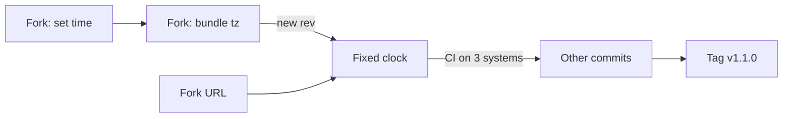

# CheapSeek 1.1: a fixed clock, a clean release, and the loose ends

## Where this starts

- CheapSeek `master` is at `162cbe8` with green CI. Release `v1.0.0` is out, and `v1` names `20f7a2b`.
- Your fork `cppalliance/rustbot` (branch `main`) is at `fb89123`, the commit CheapSeek pins. I can push to it. It has no workflows.
- The local checkout `RustBot` points at `Shekswess/RustBot`. It gains a second remote, `cppalliance`, and its `main` then follows the fork.
- Approving this plan is your word to push the fork's `main` once, to push CheapSeek's `master` seven times, to push the one tag `v1.1.0`, and to change the description of the CheapSeek repo on GitHub. The click that publishes to the Marketplace stays yours.

## What I found while planning

- **All 14 clock reads in RustBot already receive the turn's `Reading`,** so a time set on the bot can reach each one through it.
- **Time zone answers read the host's files.** On Linux and macOS, `TimeZone::get` reads `/usr/share/zoneinfo`. A host without that folder gives another reply to "What is the time difference in New York?".
- **The README's example is wrong.** The released server answers "How many days until Christmas?" with a line that has no date in it. The replies that do read the clock: the next full moon, an age from a birth year, garden advice for the month, school holidays, a due date, how long ago something began, a savings sum, and a time difference.
- **24 of the 87 MiB of the Linux executable are symbol tables** (`.strtab` and `.symtab`).
- **OpenAI refuses every request without a key before the real error shows,** and you chose to keep the wordings.

## Part 1: two commits in the fork

Each is tested with the fork's own suite (803 tests, about 8 minutes) before the push.

- **Fork commit A - a caller can set the time.**
  - `src/bot/mod.rs`: `Bot` gains `pub fn set_now(&mut self, now: Option<&str>) -> Result<(), String>`. It takes a time such as `2026-11-22T00:00:00+00:00[UTC]`, and `turn` hands it to the turn's `Reading`.
  - `src/bot/understanding/mod.rs`: `Reading` gains `now()`, which returns the set time, or the system clock when no time is set.
  - The 14 calls in 11 files call `reading.now()`. `src/main.rs` gains the flag `--now TIME`.
  - Tests: a bot set to two times gives two full moon replies, and each equals what `full_moon_at` gives for that time. A time that cannot be read is an error.
  - Each changed file gets a notice line, as section 4(b) of the Apache License asks, and the fork's README gets a section "Changes in this fork".
- **Fork commit B - time zones come from inside the executable.** `Cargo.toml` turns on jiff's `tzdb-bundle-always`, and the three lookups in `src/bot/knowledge/travel_clock.rs` go through `TimeZoneDatabase::bundled()`. Test: the existing zone test and the suite.

## Part 2: the commits in CheapSeek

The five checks of `AGENTS.md` run before each commit, and each message ends with the `Plan:` line.

- **Commit 0 - the plan copy, with links that work on GitHub.** The copy goes to `plan/`, and [AGENTS.md](../AGENTS.md) changes its copy rule: a link to a file of this repo becomes a relative link, and a link to any other file on the machine becomes the file's name. The seven such links in [the second plan copy](2026-11-22-2-release-action.plan.md) are fixed the same way. Test: a search of the repo for `c:\Users` finds nothing.
- **Commit 1 - build RustBot from the fork.** [Cargo.toml](../Cargo.toml) and [deny.toml](../deny.toml) name `https://github.com/cppalliance/rustbot` at the same commit, `Cargo.lock` follows, and the README and AGENTS name the fork. Test: every recorded reply is unchanged. **Push 1.**
- **Commit 2 - the bot's clock is the `created` time.**
  - `Cargo.toml` pins the fork's new head. [src/brain.rs](../src/brain.rs) sets each new bot to `2026-11-22T00:00:00+00:00[UTC]`, which is the constant `created` (1795305600) in UTC.
  - Unit tests: recorded replies for the full moon, the garden month, an age from a birth year and the time difference in New York. A brain set to another day gives another full moon. The time constant equals `created`.
  - Tests over HTTP: the same recorded replies. One test starts the executable with `TZ` set to a far zone and `TZDIR` set to an empty folder, and it gets the same bytes.
  - `action/check/` gains a third request, the time difference in New York, so every release executable is held to the fixed clock and the bundled zones.
  - [ci.yml](../.github/workflows/ci.yml) gains a weekly run. The recorded replies hold a date, so a run on a later day shows that the host clock is unused.
  - README "What is repeatable": the clock and the zones are fixed, the wrong example goes, and the math library stays as the one thing outside the request. AGENTS: test conversations may ask about dates.
  - **Push 2. CI on three systems is the gate:** the dated replies must be the same bytes on Linux, macOS and Windows.
- **Commit 3 - a bot that panics, through the whole replay.** In `src/brain.rs` the function that runs one bot turn becomes a parameter of the replay body. Tests: a turn that panics gives the fallback line, the brain keeps no bot of that conversation, the same request with a working turn then gets the right reply, and other conversations are untouched. Replies are unchanged.
- **Commit 4 - line coverage is measured in CI.** `rust-toolchain.toml` adds `llvm-tools`. `ci.yml` gains a `coverage` job on Ubuntu that runs `cargo llvm-cov --locked`, writes the summary to the job page, and fails below a floor. The floor is the measured number rounded down to a whole percent, and `ci-green` needs the job. Test: the same command here gives the number.
- **Commit 5 - tests for the lines the measurement shows.** Each uncovered line that a request can reach gets a test, and the floor rises to the new number. The record lists the lines that stay uncovered and why. If the measurement shows no such line, this commit is dropped and the record says so. **Push 3.**
- **Commit 6 - the Windows executable links its C runtime.** [.cargo/config.toml](../.cargo/config.toml) adds `-C target-feature=+crt-static` for the MSVC target, next to `-D warnings`. A test on Windows reads the built executable and fails when it names `vcruntime140.dll`.
- **Commit 7 - release executables are stripped.** `Cargo.toml` gains `[profile.release] strip = true`. The `build` job of [release.yml](../.github/workflows/release.yml) fails when the Linux file still has a `.symtab` section. Test here: the release build starts and passes `action/check.sh`. **Push 4, then a manual Release run:** it shows the sizes and tests commits 6 and 7 in release builds on three systems.
- **Commit 8 - a release builds from an empty cache.** The cache step leaves `release.yml`, so a manual run and a tag run compile the same way.
- **Commit 9 - every action is pinned by commit.** `ci.yml` and `release.yml` name `actions/checkout` at `3d3c42e` (v7.0.1), `actions/upload-artifact` at `cf430e0` (v7.0.2) and `actions/download-artifact` at `9000827` (v8.0.2), each as the full hash with the version in a comment.
- **Commit 10 - each release holds the licenses of what it links.** New `about.toml` and `about.hbs` for `cargo-about`. `release.yml` gains a `licenses` job that writes `THIRD-PARTY-LICENSES.html`, and `publish` adds it to the release. The `supply-chain` job of `ci.yml` runs the same generator, so a crate with an unlisted license fails on the push and not on the tag. Test here: the file names `rustbot` and holds the text of the Apache License. README and AGENTS follow. **Push 5, then a manual Release run:** it tests commits 8 to 10.
- **Commit 11 - four corrections in the docs.**
  - `AGENTS.md` and `action/start.sh`: the action and the executable come from one commit at a release tag. A later commit of `master` starts the executable of the last release.
  - README "Run": a `curl` command for each system, which is the way the action downloads and the way CI tests. A file that a browser downloaded on a Mac needs `xattr -d com.apple.quarantine` first.
  - README "Errors": the `message` is CheapSeek's own text, and a test matches on the status and the `code`.
  - README notices: the release holds the license file.
- **Commit 12 - the action is ready for its Marketplace listing.** `action.yml` gains `branding` with the icon `package` and the color `orange`, which the listing shows. The "Releases" section of `AGENTS.md` gains the rule that the owner publishes each release to the Marketplace on its release page. GitHub checks the metadata on that page, so the test of this commit is your click in Part 3.
- **Commit 13 - version 1.1.0.** `Cargo.toml` and `Cargo.lock`. **Push 6,** CI green, then the tag `v1.1.0`. Watch the Release run to its end: five files in the release, `v1` on the tagged commit, `proof` green on three systems.
- **After the release:** the description of the repo on GitHub becomes "An OpenAI-compatible test server: rule-based chat from RustBot, plus tool calls, streaming and structured output, with zero inference".
- **Commit 14 - the record.** "What the build found" and the todo statuses in the plan copy. It lists the Marketplace step as the one thing still open. **Push 7.**

## Part 3: the Marketplace, as the final step

GitHub publishes an action only from the web page of a release, by a signed-in person. So this step is four clicks of yours, and I prepare and check everything around them.

- **What is already in place:** the repo is public, it has one `action.yml` at its root, and the name `CheapSeek` is free today, both as a GitHub account and as a Marketplace listing. You are an owner of `cppalliance`, so you can accept the agreement.
- **Your clicks,** on the page of release `v1.1.0`, which I link when the release is out:
  1. Edit the release, and tick "Publish this Action to the GitHub Marketplace".
  2. The first time, follow the link to accept the GitHub Marketplace Developer Agreement for `cppalliance`. Publishing also needs two-factor sign-in on your account.
  3. Pick the categories. I suggest "Testing" first and "Continuous integration" second.
  4. Click "Update release".
- **If the page shows a problem with the metadata,** tell me what it says. I fix `action.yml` on `master`, and the fix ships as `v1.1.1`.
- **My check after your word:** `https://github.com/marketplace/actions/cheapseek` answers and shows `v1.1.0`, and the mascot and the snippet from the README show on it.
- **Every later release needs the same tick.** A release that the workflow makes is listed only after it.

## What each step needs, and what runs side by side

- Commit 2 needs the hash of the fork's head after both fork commits are pushed. Its recorded replies come from one run of the local server and are read before they are saved.
- Commit 5 needs the missing lines that commit 4's measurement prints.
- Commit 10's file name goes into `release.yml`, the README and AGENTS in the same commit.
- The fork's test runs take about 8 minutes each. Commits 0 and 1 are written while the first one runs.
- Every other commit depends only on the one before it.

## Choices I settled

- **The time is set on each bot, through `Reading`** (confidence high - all 14 places already receive it, and the bot keeps its state in one value).
- **The time is the `created` constant in UTC** (confidence medium - one constant serves both, and any fixed time would do).
- **The zone database is bundled** (confidence high - it is the only way the host's files stop mattering).
- **The release is `v1.1.0`** (confidence high - dated replies change, and every other reply keeps its bytes).
- **The static runtime goes into `.cargo/config.toml`,** so the tests run the linkage that ships (confidence medium - Windows rebuilds once).
- **`release.yml` loses its cache for manual runs too** (confidence medium - about four more minutes per run, and both kinds of run then build alike).
- **The license file is the stock HTML of `cargo-about`** (confidence medium - it is the standard tool for this).
- **The listing's icon is `package`, a cardboard box, in `orange`** (confidence medium - it matches the mascot, and it is one line to change).
- **The Marketplace click is yours** (confidence high - it needs your signed-in session, and the first time it accepts a legal agreement for `cppalliance`).

## Not in this plan

- A check of the error wordings against the live OpenAI API, by your choice.
- The system's math library. A few sums can differ in their last digit between systems. No reply has been seen to differ, and the fix would be the `libm` crate in the fork.
- CI for the fork, and a pull request or a comment upstream. The two fork commits are written to stand alone, so either is yours to decide later.
- A test of a browser download on a Mac, which needs a Mac.
- Path filters for commits that only change docs. A skipped workflow would leave the `ci-green` check waiting.
- More systems, signing, crates.io, and the "Build next" features.

## Risks and stop rules

- **The dated replies differ between systems in CI after push 2.** Stop and re-plan. Commit 1 stays as the fallback.
- **`+crt-static` fails to build.** Move the flag to the Windows row of `release.yml` alone, and the record says so.
- **Coverage reads low for `main.rs`.** A server that a test stops by force writes no coverage data. The floor comes from what the tool measures, so this lowers the number and breaks nothing.
- **`cargo-about` finds no license text for a crate.** Name the license for that crate in `about.toml`, and list the crate in the record.
- **The first tag run with the new jobs fails.** Fix it on `master` and release `v1.1.1`.
- **Someone takes the name `CheapSeek` on GitHub or on the Marketplace before your click.** The release page then refuses the name. The `name` in `action.yml` becomes "CheapSeek test server", and that ships as `v1.1.1`.
- **GitHub advises a repository that holds the action alone.** This one also holds the server the action starts. The three rules GitHub enforces are met, so I expect the page to accept it, and your click is the test.
