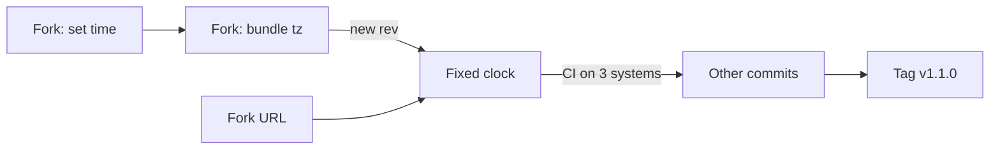

# CheapSeek 1.1: a fixed clock, a clean release, and the loose ends

## Where this starts

- CheapSeek `master` is at `162cbe8` with green CI. Release `v1.0.0` is out, and `v1` names `20f7a2b`.
- Your fork `cppalliance/rustbot` (branch `main`) is at `fb89123`, the commit CheapSeek pins. I can push to it. It has no workflows.
- The local checkout `RustBot` points at `Shekswess/RustBot`. It gains a second remote, `cppalliance`, and its `main` then follows the fork.
- Approving this plan is your word to push the fork's `main` once, to push CheapSeek's `master` seven times, to push the one tag `v1.1.0`, and to change the description of the CheapSeek repo on GitHub. The click that publishes to the Marketplace stays yours.

## What I found while planning

- **All 14 clock reads in RustBot already receive the turn's `Reading`,** so a time set on the bot can reach each one through it.
- **Time zone answers read the host's files.** On Linux and macOS, `TimeZone::get` reads `/usr/share/zoneinfo`. A host without that folder gives another reply to "What is the time difference in New York?".
- **The README's example is wrong.** The released server answers "How many days until Christmas?" with a line that has no date in it. The replies that do read the clock: the next full moon, an age from a birth year, garden advice for the month, school holidays, a due date, how long ago something began, a savings sum, and a time difference.
- **24 of the 87 MiB of the Linux executable are symbol tables** (`.strtab` and `.symtab`).
- **OpenAI refuses every request without a key before the real error shows,** and you chose to keep the wordings.

## Part 1: two commits in the fork

Each is tested with the fork's own suite (803 tests, about 8 minutes) before the push.

- **Fork commit A - a caller can set the time.**
  - `src/bot/mod.rs`: `Bot` gains `pub fn set_now(&mut self, now: Option<&str>) -> Result<(), String>`. It takes a time such as `2026-11-22T00:00:00+00:00[UTC]`, and `turn` hands it to the turn's `Reading`.
  - `src/bot/understanding/mod.rs`: `Reading` gains `now()`, which returns the set time, or the system clock when no time is set.
  - The 14 calls in 11 files call `reading.now()`. `src/main.rs` gains the flag `--now TIME`.
  - Tests: a bot set to two times gives two full moon replies, and each equals what `full_moon_at` gives for that time. A time that cannot be read is an error.
  - Each changed file gets a notice line, as section 4(b) of the Apache License asks, and the fork's README gets a section "Changes in this fork".
- **Fork commit B - time zones come from inside the executable.** `Cargo.toml` turns on jiff's `tzdb-bundle-always`, and the three lookups in `src/bot/knowledge/travel_clock.rs` go through `TimeZoneDatabase::bundled()`. Test: the existing zone test and the suite.

## Part 2: the commits in CheapSeek

The five checks of `AGENTS.md` run before each commit, and each message ends with the `Plan:` line.

- **Commit 0 - the plan copy, with links that work on GitHub.** The copy goes to `plan/`, and [AGENTS.md](../AGENTS.md) changes its copy rule: a link to a file of this repo becomes a relative link, and a link to any other file on the machine becomes the file's name. The seven such links in [the second plan copy](2026-11-22-2-release-action.plan.md) are fixed the same way. Test: a search of the repo for `c:\Users` finds nothing.
- **Commit 1 - build RustBot from the fork.** [Cargo.toml](../Cargo.toml) and [deny.toml](../deny.toml) name `https://github.com/cppalliance/rustbot` at the same commit, `Cargo.lock` follows, and the README and AGENTS name the fork. Test: every recorded reply is unchanged. **Push 1.**
- **Commit 2 - the bot's clock is the `created` time.**
  - `Cargo.toml` pins the fork's new head. [src/brain.rs](../src/brain.rs) sets each new bot to `2026-11-22T00:00:00+00:00[UTC]`, which is the constant `created` (1795305600) in UTC.
  - Unit tests: recorded replies for the full moon, the garden month, an age from a birth year and the time difference in New York. A brain set to another day gives another full moon. The time constant equals `created`.
  - Tests over HTTP: the same recorded replies. One test starts the executable with `TZ` set to a far zone and `TZDIR` set to an empty folder, and it gets the same bytes.
  - `action/check/` gains a third request, the time difference in New York, so every release executable is held to the fixed clock and the bundled zones.
  - [ci.yml](../.github/workflows/ci.yml) gains a weekly run. The recorded replies hold a date, so a run on a later day shows that the host clock is unused.
  - README "What is repeatable": the clock and the zones are fixed, the wrong example goes, and the math library stays as the one thing outside the request. AGENTS: test conversations may ask about dates.
  - **Push 2. CI on three systems is the gate:** the dated replies must be the same bytes on Linux, macOS and Windows.
- **Commit 3 - a bot that panics, through the whole replay.** In `src/brain.rs` the function that runs one bot turn becomes a parameter of the replay body. Tests: a turn that panics gives the fallback line, the brain keeps no bot of that conversation, the same request with a working turn then gets the right reply, and other conversations are untouched. Replies are unchanged.
- **Commit 4 - line coverage is measured in CI.** `rust-toolchain.toml` adds `llvm-tools`. `ci.yml` gains a `coverage` job on Ubuntu that runs `cargo llvm-cov --locked`, writes the summary to the job page, and fails below a floor. The floor is the measured number rounded down to a whole percent, and `ci-green` needs the job. Test: the same command here gives the number.
- **Commit 5 - tests for the lines the measurement shows.** Each uncovered line that a request can reach gets a test, and the floor rises to the new number. The record lists the lines that stay uncovered and why. If the measurement shows no such line, this commit is dropped and the record says so. **Push 3.**
- **Commit 6 - the Windows executable links its C runtime.** [.cargo/config.toml](../.cargo/config.toml) adds `-C target-feature=+crt-static` for the MSVC target, next to `-D warnings`. A test on Windows reads the built executable and fails when it names `vcruntime140.dll`.
- **Commit 7 - release executables are stripped.** `Cargo.toml` gains `[profile.release] strip = true`. The `build` job of [release.yml](../.github/workflows/release.yml) fails when the Linux file still has a `.symtab` section. Test here: the release build starts and passes `action/check.sh`. **Push 4, then a manual Release run:** it shows the sizes and tests commits 6 and 7 in release builds on three systems.
- **Commit 8 - a release builds from an empty cache.** The cache step leaves `release.yml`, so a manual run and a tag run compile the same way.
- **Commit 9 - every action is pinned by commit.** `ci.yml` and `release.yml` name `actions/checkout` at `3d3c42e` (v7.0.1), `actions/upload-artifact` at `cf430e0` (v7.0.2) and `actions/download-artifact` at `9000827` (v8.0.2), each as the full hash with the version in a comment.
- **Commit 10 - each release holds the licenses of what it links.** New `about.toml` and `about.hbs` for `cargo-about`. `release.yml` gains a `licenses` job that writes `THIRD-PARTY-LICENSES.html`, and `publish` adds it to the release. The `supply-chain` job of `ci.yml` runs the same generator, so a crate with an unlisted license fails on the push and not on the tag. Test here: the file names `rustbot` and holds the text of the Apache License. README and AGENTS follow. **Push 5, then a manual Release run:** it tests commits 8 to 10.
- **Commit 11 - four corrections in the docs.**
  - `AGENTS.md` and `action/start.sh`: the action and the executable come from one commit at a release tag. A later commit of `master` starts the executable of the last release.
  - README "Run": a `curl` command for each system, which is the way the action downloads and the way CI tests. A file that a browser downloaded on a Mac needs `xattr -d com.apple.quarantine` first.
  - README "Errors": the `message` is CheapSeek's own text, and a test matches on the status and the `code`.
  - README notices: the release holds the license file.
- **Commit 12 - the action is ready for its Marketplace listing.** `action.yml` gains `branding` with the icon `package` and the color `orange`, which the listing shows. The "Releases" section of `AGENTS.md` gains the rule that the owner publishes each release to the Marketplace on its release page. GitHub checks the metadata on that page, so the test of this commit is your click in Part 3.
- **Commit 13 - version 1.1.0.** `Cargo.toml` and `Cargo.lock`. **Push 6,** CI green, then the tag `v1.1.0`. Watch the Release run to its end: five files in the release, `v1` on the tagged commit, `proof` green on three systems.
- **After the release:** the description of the repo on GitHub becomes "An OpenAI-compatible test server: rule-based chat from RustBot, plus tool calls, streaming and structured output, with zero inference".
- **Commit 14 - the record.** "What the build found" and the todo statuses in the plan copy. It lists the Marketplace step as the one thing still open. **Push 7.**

## Part 3: the Marketplace, as the final step

GitHub publishes an action only from the web page of a release, by a signed-in person. So this step is four clicks of yours, and I prepare and check everything around them.

- **What is already in place:** the repo is public, it has one `action.yml` at its root, and the name `CheapSeek` is free today, both as a GitHub account and as a Marketplace listing. You are an owner of `cppalliance`, so you can accept the agreement.
- **Your clicks,** on the page of release `v1.1.0`, which I link when the release is out:
  1. Edit the release, and tick "Publish this Action to the GitHub Marketplace".
  2. The first time, follow the link to accept the GitHub Marketplace Developer Agreement for `cppalliance`. Publishing also needs two-factor sign-in on your account.
  3. Pick the categories. I suggest "Testing" first and "Continuous integration" second.
  4. Click "Update release".
- **If the page shows a problem with the metadata,** tell me what it says. I fix `action.yml` on `master`, and the fix ships as `v1.1.1`.
- **My check after your word:** `https://github.com/marketplace/actions/cheapseek` answers and shows `v1.1.0`, and the mascot and the snippet from the README show on it.
- **Every later release needs the same tick.** A release that the workflow makes is listed only after it.

## What each step needs, and what runs side by side

- Commit 2 needs the hash of the fork's head after both fork commits are pushed. Its recorded replies come from one run of the local server and are read before they are saved.
- Commit 5 needs the missing lines that commit 4's measurement prints.
- Commit 10's file name goes into `release.yml`, the README and AGENTS in the same commit.
- The fork's test runs take about 8 minutes each. Commits 0 and 1 are written while the first one runs.
- Every other commit depends only on the one before it.

## Choices I settled

- **The time is set on each bot, through `Reading`** (confidence high - all 14 places already receive it, and the bot keeps its state in one value).
- **The time is the `created` constant in UTC** (confidence medium - one constant serves both, and any fixed time would do).
- **The zone database is bundled** (confidence high - it is the only way the host's files stop mattering).
- **The release is `v1.1.0`** (confidence high - dated replies change, and every other reply keeps its bytes).
- **The static runtime goes into `.cargo/config.toml`,** so the tests run the linkage that ships (confidence medium - Windows rebuilds once).
- **`release.yml` loses its cache for manual runs too** (confidence medium - about four more minutes per run, and both kinds of run then build alike).
- **The license file is the stock HTML of `cargo-about`** (confidence medium - it is the standard tool for this).
- **The listing's icon is `package`, a cardboard box, in `orange`** (confidence medium - it matches the mascot, and it is one line to change).
- **The Marketplace click is yours** (confidence high - it needs your signed-in session, and the first time it accepts a legal agreement for `cppalliance`).

## Not in this plan

- A check of the error wordings against the live OpenAI API, by your choice.
- The system's math library. A few sums can differ in their last digit between systems. No reply has been seen to differ, and the fix would be the `libm` crate in the fork.
- CI for the fork, and a pull request or a comment upstream. The two fork commits are written to stand alone, so either is yours to decide later.
- A test of a browser download on a Mac, which needs a Mac.
- Path filters for commits that only change docs. A skipped workflow would leave the `ci-green` check waiting.
- More systems, signing, crates.io, and the "Build next" features.

## Risks and stop rules

- **The dated replies differ between systems in CI after push 2.** Stop and re-plan. Commit 1 stays as the fallback.
- **`+crt-static` fails to build.** Move the flag to the Windows row of `release.yml` alone, and the record says so.
- **Coverage reads low for `main.rs`.** A server that a test stops by force writes no coverage data. The floor comes from what the tool measures, so this lowers the number and breaks nothing.
- **`cargo-about` finds no license text for a crate.** Name the license for that crate in `about.toml`, and list the crate in the record.
- **The first tag run with the new jobs fails.** Fix it on `master` and release `v1.1.1`.
- **Someone takes the name `CheapSeek` on GitHub or on the Marketplace before your click.** The release page then refuses the name. The `name` in `action.yml` becomes "CheapSeek test server", and that ships as `v1.1.1`.
- **GitHub advises a repository that holds the action alone.** This one also holds the server the action starts. The three rules GitHub enforces are met, so I expect the page to accept it, and your click is the test.

# What the build found

The plan held. Release `v1.1.0` is published, the bot's clock stands still, and every run was green on Linux, macOS and Windows. Each step passed on its first run in CI, and the gate after push 2 passed. This record was written after the Release run of the tag ended and before push 7. The points below differ from the plan above, or add to it.

## The result

- **Release [v1.1.0](https://github.com/cppalliance/cheapseek/releases/tag/v1.1.0)** holds five files: three executables, `SHA256SUMS` and `THIRD-PARTY-LICENSES.html`. The tags `v1.1.0` and `v1` both name commit `54d18eb`, and `v1.0.0` still names `20f7a2b`.
- **The Release run of the tag, 45100041981, was green in 6.2 minutes.** Each `proof` job downloaded `cppalliance/cheapseek@v1` at `54d18eb` and got the three recorded replies.
- **The fork [cppalliance/rustbot](https://github.com/cppalliance/rustbot) holds two commits** on top of `fb89123`: `6e51ec6` and `866aac5`. CheapSeek pins `866aac5`.
- **Commits here: sixteen where the plan lists fifteen.** The extra one raises the coverage floor after CI gave its number. `master` was pushed seven times, the fork once, and one tag was pushed.
- **Tests:** 125 unit tests, 85 tests over HTTP and 1 doc test on each of the three systems. Before this plan the counts were 113, 77 and 1.
- **Line coverage:** 99.18 percent on Ubuntu, where 12 of 1,468 lines stay without a test. The floor is 99.
- **Sizes of the executables:** 66.3 MB for Linux, where release 1.0.0 had 91.4. 41.2 MB for macOS, where it had 58.4. 46.2 MB for Windows, as before.
- **The description of the repository on GitHub** now reads "An OpenAI-compatible test server: rule-based chat from RustBot, plus tool calls, streaming and structured output, with zero inference".

## The fork

- **The time of a turn is held for the thread of the turn, and `Reading::now` reads it.** The plan put the time on the turn's `Reading`. A turn builds more readings than that one: for earlier lines, and for reworded forms of the line, in many places of the bot. A field on one reading would have left the others on the system clock. `src/bot/clock.rs` holds the time in a thread-local value while `turn` runs, and puts the earlier value back when the turn ends, also in a panic.
- **`Bot::set_now` reads its time with the bundled time zone database too,** so a time with a named zone means the same on every host.
- **The fork's own suite passed for both commits.** The whole suite ran once for each: 817 tests for the first commit, before one more test was added to it, and 821 for the second. The original has 803. The second run took 336 seconds.
- **The fork has 18 new tests.** They set two times and compare the replies for the full moon, an age, the month, a time difference, a school holiday, a due date and a length of time. The savings and budget replies are left without a test at a set time.
- **The test with `TZDIR` and `TZ` passes on Windows, where the original already takes its zones from inside the executable.** The fork's tests run on a developer machine alone, so Linux and macOS test the same thing through CheapSeek's own test.
- **The messages of the fork's commits end without a `Plan:` line,** because the plan copy is in this repository.

## Commit 0, `c4886dd`: the plan copy

- **The copy differs from the approved plan in seven lines:** nine paths became eight relative links and one folder name. The second plan copy changed in seven links.
- **The search that tests the commit looked for a path under `c:\Users`.** The plan copy itself holds the text `c:\Users` twice, where it names that search.
- **The copy is one status ahead of the approved plan:** `fork-clock` was `in_progress`.

## Commit 1, `42172bc`: the fork as the source

- **CI run 45091374902 was green.** The test jobs built the bot again from the new address and took 3.5 to 4.5 minutes.

## Commit 2, `941fcc4`: the fixed clock

- **The gate passed.** In CI run 45093825807 the dated replies were the same bytes on the three systems. The runners' clocks read 23 November, a day after the fixed time, and the full moon reply still said "in 2 days".
- **Six dated replies are recorded** in `tests/it/dates.rs`, and four of them in the unit tests. All six were read before they were saved, and each fits 22 November 2026, midnight UTC: the full moon two days on, November in the garden, an age of 36 for a birth in 1990, New York five hours behind at 7pm, the summer holiday on Wednesday 21 July 2027, and two and a half years since March 2024.
- **`Brain::at` takes the time,** so a unit test shows the replies of another day. The server uses the one constant.
- **A unit test works out the seconds of the constant from its text** and compares them with `created`.
- **The recorded replies of `chat` and `echo` in `action/check/` kept their bytes,** so the two changes of the fork touched no other reply that the tests hold.
- **On the day of the build the host clock and the fixed time gave the same date here,** so the run on this machine could not tell them apart. The run of release 1.0.0 with a time difference showed the host's minutes, and CI ran a day later.

## Commit 3, `9c0fedc`: a bot that panics

- **Three tests run a turn that panics through the whole replay:** on a new bot, on a kept bot, and beside requests of other conversations on other threads. The fallback line is never kept as the reply of a conversation.
- **A panic inside the code of the bot itself is still without a test.**

## Commits 4 and 5, `84f6621` and `cbbb088`, and the extra commit `789e1ac`: coverage

- **The first count, on this Windows machine, was 95.44 percent of 1,468 lines,** so the floor started at 95.
- **The count found one behavior that the README did not list:** a body over 64 MiB gets a 413. The README lists it now, and two tests send a body of the largest size and one byte more.
- **The other lines with a new test:** a request without a user message, a message with the role `function`, a `$ref` that leads nowhere, an object that requires more properties than a run may make, `warm_up`, and the 500 of a reply that the server cannot write. The last one is a unit test, because no request reaches it.
- **A test sends `SIGINT` to the executable on Linux and macOS,** and the executable ends with success. That covers the lines of `main` after the port is bound. The test runs on those two systems alone, because only they have a command that sends the signal to one process.
- **CI run 45095738987 counted 99.18 percent on Ubuntu.** The floor in `cbbb088` was 98, from the 98.23 percent of the Windows machine, where the `SIGINT` test does not run. `789e1ac` raises it to 99, the number of the job that holds it.
- **The lines that stay without a test:** a check in `src/brain.rs` that the compiler runs, a branch there that its loop rules out, an arm in `src/directive.rs` that no input reaches, and the lines of `src/main.rs` that run when the handler for Ctrl-C cannot be installed.
- **The standard library for the Linux target was added to the toolchain of this machine,** so that clippy could check the test code that Windows does not compile.

## Commit 6, `7a52565`: the C runtime inside the Windows executable

- **The target table repeats `-D warnings`.** Cargo takes the flags of a matching target table in place of the `[build]` flags, so the setting could not sit beside them as the plan said.
- **The built executable names six libraries, all parts of Windows.** Before the change it also named `vcruntime140.dll` and six parts of the Universal C Runtime.
- **A build by `cargo install` does not read `.cargo/config.toml`** and links the runtime as before.

## Commit 7, `43ccc0c`: stripped executables

- **The manual Release run 45097596262 gave the sizes:** 66.3 MB for Linux and 41.2 MB for macOS. The Windows executable keeps its size, because its symbols were never inside it.
- **The tools applied one batch of edits twice,** which doubled the profile in `Cargo.toml` and the new step in `release.yml`. The build failed on the doubled profile before the commit, and both files were corrected.

## Commits 8 and 9, `31bf9dc` and `113d3a3`: clean builds and pinned actions

- **A release build from an empty cache takes 160 to 231 seconds** on the three systems, in the manual run 45099088061 and in the run of the tag.
- **Commit 9 changed eleven places:** nine checkouts, one upload and one download. The jobs of commit 10 name their actions by commit from the start.

## Commit 10, `1aa17ce`: the page of licenses

- **The page lists 102 crates under five licenses** and is 230,443 bytes. The page that the manual run made on Ubuntu and the page made on this Windows machine hold the same text.
- **`cargo-about` 0.9.2 reads the license of each crate from its source alone.** It asks a web service for nothing, and it found a text for every crate. `mt19937` names a license file in place of a license field, and the page holds the text of that file.
- **`SHA256SUMS` lists the page too.**
- **`cargo-about` 0.9.2 was downloaded into a scratch folder** for the test on this machine, and its sum matched the published one.

## Commits 11 to 13, `693d705`, `e1cb320` and `54d18eb`

- **The fourth correction of commit 11 was already in commit 10:** the README says there that each release holds the page of licenses.
- **The download addresses in the README were tried against release 1.0.0** and each answered.
- **The name `CheapSeek` was still free** on GitHub and in the Marketplace when the branding was committed.
- **CI run 45099787164 on `54d18eb` was green** before the tag was pushed.

## The tag `v1.1.0`

- **All five files were downloaded to this machine,** and each of the four that `SHA256SUMS` lists matches its sum. The action then ran here with the real download and got the three recorded replies.
- **The Windows executable of the release names libraries of Windows alone,** and it answers the dated questions as recorded.
- **`v1` moved through the GitHub API for the first time,** from `20f7a2b` to `54d18eb`.
- **One start of the action took 34 seconds,** in the `proof` job on Windows. The five other starts in that run took 3 to 6 seconds, and the script waits up to 120.

## The risks, looked at again

- **The dated replies** are the same bytes on the three systems.
- **`+crt-static`** built on the first try.
- **Coverage of `main.rs`** is 97 percent on Ubuntu, because the `SIGINT` test lets the executable end by itself.
- **`cargo-about`** found a license text for every crate.
- **The first tag run with the new jobs** passed.
- **The name and the shape of the repository** are still to be tested by the owner's click.

## Still open when this record was written

- **The listing in the Marketplace.** It is four clicks of the owner on the page of release 1.1.0, and Part 3 above lists them.
- **Push 7 and its CI run.** They come after this commit, so the chat reports them.
- **The notes of release 1.1.0 are the ones GitHub generates.** A reader learns from the README alone that replies with a date in them changed.
- **The first weekly run of CI** comes on the Monday after the release.
- **The issue on RustBot is open and waits for an answer.** A pull request with the two commits of the fork is the owner's to decide.
- **The tests of the fork run on a developer machine alone.**
- **A few sums of the bot follow the system's math library.** No reply has been seen to differ.
- **A download through a browser on a Mac,** and the words of the error messages against the live OpenAI API, are untested, as the plan says.
